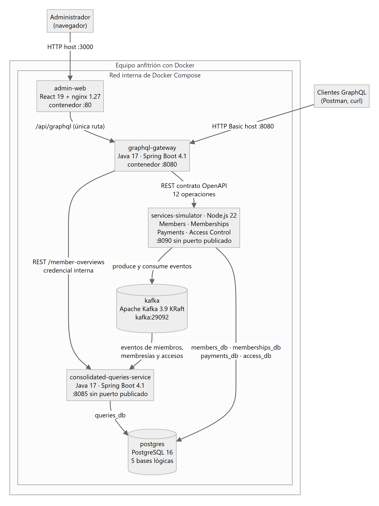

# Plataforma distribuida de membresías y control de acceso

**Grupo 2 – Equipo 2** · Programación Avanzada · Ingeniería de Software · Fundación Escuela Tecnológica de Neiva “Jesús Oviedo Pérez” (FET)

Plataforma para gestionar miembros, planes, membresías, pagos y control de acceso de un gimnasio, construida con servicios independientes que se comunican por REST, GraphQL y eventos de Apache Kafka, y que se ejecuta completa con Docker Compose.

- Repositorio: <https://github.com/Somersett/PA_G2_Equipo2_Entrega2P1>
- Informe de pruebas (Word y PDF): [`docs/informe/`](docs/informe/)

## Contenido de la entrega

| Elemento solicitado | Dónde está |
| --- | --- |
| Frontend (panel administrativo React + nginx) | [`clients/admin-web/`](clients/admin-web/) |
| GraphQL Gateway (Spring Boot) | [`gateways/graphql-gateway/`](gateways/graphql-gateway/) |
| Servicio de consultas consolidadas (Spring Boot) | [`services/consolidated-queries-service/`](services/consolidated-queries-service/) |
| Members, Memberships, Payments y Access Control (simulador Node.js con los mismos contratos) | [`simulator/`](simulator/) |
| Diagramas, responsabilidades y comunicación entre componentes | [`docs/arquitectura.md`](docs/arquitectura.md), [`docs/diagramas/`](docs/diagramas/) |
| Dockerfiles y Docker Compose (servicios, red, volumen, dependencias y healthchecks) | `*/Dockerfile`, [`infrastructure/docker-compose.yml`](infrastructure/docker-compose.yml) |
| Scripts y migraciones de base de datos, datos ficticios para pruebas | [`infrastructure/postgres/init/`](infrastructure/postgres/init/), migración Flyway, [`simulator/src/db.js`](simulator/src/db.js), [`scripts/herramientas/`](scripts/herramientas/) |
| Variables de ejemplo sin secretos reales | [`infrastructure/.env.example`](infrastructure/.env.example) |
| Documentación de API | [`docs/api.md`](docs/api.md) y [`contracts/`](contracts/) |
| Manual técnico | [`docs/manual-tecnico.md`](docs/manual-tecnico.md) |
| Manual de instalación y uso | [`docs/manual-instalacion-uso.md`](docs/manual-instalacion-uso.md) |
| Pruebas, matriz de pruebas y evidencias | [`docs/pruebas-y-evidencias.md`](docs/pruebas-y-evidencias.md), [`docs/evidencias/`](docs/evidencias/), [`docs/informe/`](docs/informe/) |

## Requisitos y dependencias externas

| Dependencia | Para qué | Obligatoria |
| --- | --- | --- |
| [Docker Desktop](https://www.docker.com/products/docker-desktop/) (Windows o macOS) o Docker Engine con Compose v2 (Linux) | Construir y ejecutar todos los componentes | Sí |
| Conexión a internet (solo la primera vez) | Descargar imágenes de Docker Hub (`postgres:16-alpine`, `apache/kafka:3.9.0`, `maven:3.9.11-eclipse-temurin-17`, `eclipse-temurin:17-jre`, `node:22-alpine`, `node:22-slim`, `nginx:1.27-alpine`) y dependencias de Maven Central y del registro de npm | Sí, la primera vez |
| Navegador web | Usar el panel | Sí |
| Java 17, Node.js 22, curl, jq | Solo para desarrollar o ejecutar pruebas fuera de Docker | No |

No hay servicios externos en la nube: no se usan pasarelas de pago, correo, autenticación federada ni bases de datos administradas.

## Inicio rápido

1. Instale y abra Docker Desktop.
2. Descomprima el ZIP en una carpeta nueva (o clone el repositorio).
3. Windows: doble clic en `iniciar.bat`. macOS o Linux: `bash iniciar.sh`.
4. Espere el mensaje **“Todo está en marcha”** (la primera vez, de 5 a 15 minutos). Se abre <http://localhost:3000>.
5. Ingrese con el usuario `admin` y la contraseña `cambie-esta-clave-admin` (están en `infrastructure/.env`, creado a partir de `.env.example`).
6. Opcional: `datos-demo.bat` o `bash datos-demo.sh` carga 8 miembros ficticios con membresías, pagos e ingresos.

Guía completa con capturas: [manual de instalación y uso](docs/manual-instalacion-uso.md).

## Orden de ejecución

`iniciar` hace todo en este orden; los mismos pasos se pueden ejecutar a mano desde la carpeta `infrastructure`:

| Paso | Qué ocurre | Comando manual equivalente |
| --- | --- | --- |
| 1 | Verifica que Docker responda | `docker info` |
| 2 | Crea `infrastructure/.env` si no existe | `cp .env.example .env` |
| 3 | Revisa que los puertos estén libres; si no, elige otros y los guarda en `.env` | — |
| 4 | Construye las imágenes y levanta PostgreSQL y Kafka; espera a que estén saludables | `docker compose --profile apps up -d --build --wait` |
| 5 | Con la base y Kafka listos, arrancan Consolidated Queries (aplica su migración Flyway) y el simulador (crea sus tablas y los planes iniciales) | (incluido en el paso 4, por `depends_on`) |
| 6 | Arranca el GraphQL Gateway y luego el panel | (incluido en el paso 4) |
| 7 | Opcional: carga datos ficticios por el gateway | `docker compose --profile apps --profile herramientas run --rm herramientas` |

## Comandos

| Acción | Windows | macOS o Linux |
| --- | --- | --- |
| Iniciar todo y abrir el panel | `iniciar.bat` | `bash iniciar.sh` |
| Detener (conserva los datos) | `detener.bat` | `bash detener.sh` |
| Borrar todos los datos y tópicos | `borrar-datos.bat` | `bash borrar-datos.sh` |
| Cargar datos ficticios | `datos-demo.bat` | `bash datos-demo.sh` |
| Probar entrada única y tolerancia a fallos (35 comprobaciones) | `probar-fallos.bat` | — |
| Generar el ZIP de la versión actual | `empaquetar.bat` | `git archive --format=zip -o proyecto.zip HEAD` |
| Ver el estado de los contenedores | `cd infrastructure` y `docker compose --profile apps ps` | igual |
| Ver los registros de un servicio | `docker compose --profile apps logs -f graphql-gateway` | igual |
| Medir latencias reales | `docker compose --profile apps --profile herramientas run --rm herramientas medir-latencias.mjs` | igual |

Pruebas automatizadas de cada componente: ver el [manual técnico](docs/manual-tecnico.md#7-pruebas).

## Puertos

| Puerto en el equipo | Componente | Acceso |
| --- | --- | --- |
| `3000` | Panel administrativo (nginx) | Navegador. Solo reenvía `/api/graphql` al gateway |
| `8080` | GraphQL Gateway (`/graphql`, `/actuator/health`) | Clientes GraphQL con HTTP Basic |
| `127.0.0.1:5432` | PostgreSQL | Solo este equipo, para herramientas de desarrollo |
| `127.0.0.1:9092` | Kafka | Solo este equipo, para herramientas de desarrollo |
| — | Consolidated Queries (`8085`) y simulador (`8090`) | Sin puerto publicado: solo los alcanza el gateway dentro de la red de Docker |

Los puertos se pueden cambiar en `infrastructure/.env` (`ADMIN_WEB_PORT`, `GATEWAY_HOST_PORT`, `POSTGRES_HOST_PORT`, `KAFKA_HOST_PORT`).

## Arquitectura



| Componente | Estado | Tecnología |
| --- | --- | --- |
| Panel administrativo y simulador del torniquete | Implementado | React 19, TypeScript, Vite 8, nginx 1.27 |
| GraphQL Gateway | Implementado | Java 17, Spring Boot 4.1.2, Spring for GraphQL |
| Consolidated Queries Service | Implementado | Java 17, Spring Boot 4.1.2, Flyway, Spring Kafka |
| Members, Memberships, Payments y Access Control | **Simulados** por un servicio Node.js 22 que cumple sus contratos REST y Kafka, cada módulo con su propia base | Node.js 22, Express 5, kafkajs, pg |
| PostgreSQL (5 bases lógicas) y Apache Kafka (4 tópicos) | Implementados | PostgreSQL 16, Kafka 3.9.0 KRaft |

Flujo principal: registrar miembro → asignar plan (membresía `PENDING`) → registrar pago → Memberships activa la membresía al consumir `PAYMENT_REGISTERED` → Access Control actualiza su estado local con `MEMBERSHIP_ACTIVATED` → el torniquete valida el ingreso con ese estado → Consolidated Queries proyecta todo y el gateway responde `member(id)`. Detalle, responsabilidades, comunicación, despliegue y modelo de datos en [`docs/arquitectura.md`](docs/arquitectura.md).

### Contratos

- [`contracts/openapi/gym-platform-api.yaml`](contracts/openapi/gym-platform-api.yaml): OpenAPI 3.0.3, 12 operaciones REST.
- [`contracts/openapi/consolidated-queries-api.yaml`](contracts/openapi/consolidated-queries-api.yaml): API interna de lectura.
- [`contracts/graphql/schema.graphqls`](contracts/graphql/schema.graphqls): 9 consultas y 6 mutaciones del gateway.
- [`contracts/kafka/events.yaml`](contracts/kafka/events.yaml): 4 tópicos y 7 eventos con sobre común versionado.

### Tolerancia a fallos

Docker reinicia cualquier contenedor caído; el gateway aplica tiempos de espera, un reintento de lecturas y un disyuntor por servicio, e informa qué componente falló sin revelar detalles internos; los servicios usan outbox transaccional y consumidores idempotentes; el panel avisa cada falla con su causa y solución y se recupera solo. Detalle en [`docs/tolerancia-a-fallos.md`](docs/tolerancia-a-fallos.md).

## Pruebas

| Nivel | Resultado |
| --- | --- |
| Pruebas unitarias e integración del gateway | 49/49 |
| Pruebas unitarias e integración (con PostgreSQL y Kafka reales) de Consolidated Queries | 24/24 |
| Pruebas del simulador | 11/11 |
| Compilación del panel (TypeScript y Vite) | Correcta |
| Entrada única y tolerancia a fallos de extremo a extremo (`probar-fallos`) | 35/35 |
| Casos funcionales en el navegador, API e instalación desde el ZIP | Ver la matriz |

Matriz completa (caso, resultado esperado, resultado obtenido, estado y evidencia), resultados medidos, simulaciones y trabajo futuro: [`docs/pruebas-y-evidencias.md`](docs/pruebas-y-evidencias.md).

## Limitaciones y componentes pendientes

- **Servicios de dominio simulados:** Members, Memberships, Payments y Access Control funcionan dentro de `simulator/` (Node.js), no como cuatro servicios Spring Boot independientes. Respetan los contratos, las bases separadas, los eventos y la idempotencia, y se reemplazan cambiando `GYM_PLATFORM_BASE_URL` del gateway. Las carpetas `services/{members,memberships,payments,access-control}-service/` solo contienen su README.
- **Autenticación:** HTTP Basic con un único usuario administrador. Falta el mecanismo definitivo de autenticación y autorización, y TLS.
- **Kafka:** un solo broker sin réplicas; no hay política de reintentos ni *dead-letter topics* para mensajes no procesables.
- **Pagos y torniquete simulados:** no hay pasarela de pago real ni hardware de acceso; el torniquete es una pantalla del panel.
- **Vencimiento automático:** una tarea programada vence las membresías cada 60 s, pero las pruebas lo verificaron con el vencimiento forzado (demostración), porque observar el automático exige esperar el fin de una vigencia real.
- **Documento de la Entrega 2:** sus secciones 3.2, 7 y 11 aún describen el gateway como de solo lectura; la implementación añadió mutaciones para que el panel no llame directamente a los servicios.
- **Fuera del alcance del MVP:** aplicación móvil, autoservicio, múltiples sedes, notificaciones, facturación electrónica, contabilidad y SSO.

## Estructura

```text
├── iniciar / detener / borrar-datos / probar-fallos / datos-demo / empaquetar (.bat y .sh)
├── scripts/            lógica de los scripts de Windows y herramientas/ (datos ficticios y latencias)
├── clients/admin-web/  panel administrativo (React + nginx)
├── gateways/graphql-gateway/
├── services/consolidated-queries-service/   (y carpetas de los servicios pendientes)
├── simulator/          Members, Memberships, Payments y Access Control
├── contracts/          OpenAPI, GraphQL y eventos de Kafka
├── infrastructure/     docker-compose.yml, .env.example, init de PostgreSQL
├── docs/               arquitectura, API, manuales, pruebas, evidencias, diagramas e informe
└── PA_G2_Equipo2_Entrega2P1.pdf   documento de la Entrega 2 (requisitos, diseño y contratos)
```

## Documentación

- [Arquitectura](docs/arquitectura.md) · [API](docs/api.md) · [Manual técnico](docs/manual-tecnico.md) · [Instalación y uso](docs/manual-instalacion-uso.md) · [Pruebas y evidencias](docs/pruebas-y-evidencias.md)
- [GraphQL Gateway y Consolidated Queries en detalle](docs/api-gateway-graphql.md) · [Tolerancia a fallos](docs/tolerancia-a-fallos.md) · [Simulador](simulator/README.md)
