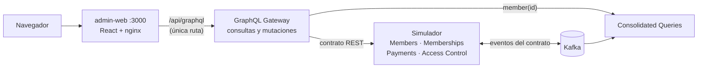

# Plataforma distribuida de membresías y control de acceso

**Identificación:** Grupo 2 - Equipo 2

Entrega técnica para la gestión de miembros, planes, membresías, pagos y control de acceso de un gimnasio. Este paquete materializa los contratos y la infraestructura descritos en el PDF principal, sin ampliar el MVP. **Componentes implementados:** GraphQL Gateway y Consolidated Queries Service (ver `docs/api-gateway-graphql.md`), más un **panel administrativo web** (`clients/admin-web`) y un **simulador** (`simulator/`) que hace las veces de Members, Memberships, Payments y Access Control, cuyos servicios Spring Boot siguen sin implementación en este repositorio.

## Ejecutarlo en cualquier equipo

Solo se necesita **[Docker Desktop](https://www.docker.com/products/docker-desktop/)** (Windows, macOS o Linux). No hace falta instalar Java, Node, PostgreSQL ni Kafka.

1. Descomprime el proyecto.
2. **Windows:** doble clic en `iniciar.bat`. **macOS / Linux:** en una terminal, dentro de la carpeta, ejecuta `bash iniciar.sh`.
3. Espera el mensaje **"Todo está en marcha"**. Se abre el navegador en **http://localhost:3000**.
4. Ingresa con el usuario `admin` y la contraseña `cambie-esta-clave-admin` (las de `infrastructure/.env`).

La primera vez tarda entre 5 y 15 minutos porque descarga las imágenes y compila los servicios. Después arranca en menos de un minuto. El script abre Docker Desktop si está cerrado, crea `infrastructure/.env` si no existe y, si algún puerto ya está ocupado (por ejemplo, por un PostgreSQL instalado), usa el siguiente libre e imprime la dirección final.

| Script (Windows / macOS-Linux) | Qué hace |
| --- | --- |
| `iniciar.bat` / `iniciar.sh` | Construye y levanta todo, y abre el panel. |
| `detener.bat` / `detener.sh` | Apaga todo. Los datos se conservan. |
| `borrar-datos.bat` / `borrar-datos.sh` | Apaga todo y borra bases y tópicos, para repetir la demostración desde cero. |
| `probar-fallos.bat` | Con la plataforma en marcha, comprueba que todo entre por el gateway y tumba uno a uno los componentes para mostrar que el sistema lo informa y se recupera solo (ver `docs/tolerancia-a-fallos.md`). |
| `empaquetar.bat` | Genera un `.zip` limpio del proyecto (sin `node_modules`, `target`, `dist` ni `.env`) en la carpeta superior. |

### Qué incluye el panel

- **Recorrido guiado** (para la sustentación): el flujo principal del PDF (§4) en cinco pasos. Registrar miembro → asignar plan → registrar pago → validar ingreso → consultar la ficha consolidada. Cada paso indica qué servicio actúa y muestra en vivo los eventos que viajan por Kafka. Al final permite vencer la membresía y comprobar el `ACCESS_DENIED`.
- **Administración:** miembros, membresías, pagos y planes (RF-01 a RF-07). Al terminar cada acción, el panel sugiere el siguiente paso del flujo.
- **Control de acceso:** simula el torniquete con la mutación `registerAccessAttempt`, que el gateway traduce a `POST /access-attempts` (RF-08, RF-09).
- **Ficha del miembro:** la vista consolidada `member(id)` del GraphQL Gateway (RF-10), con la consulta y la respuesta reales a la vista.
- **Eventos Kafka:** todo lo que pasa por los cuatro tópicos, leído directamente del broker.
- **Estado del sistema:** lo informa el gateway (`systemStatus`): él mismo, el simulador, Consolidated Queries, Kafka y PostgreSQL. Responde aunque algún componente esté caído.
- **Avisos de fallos:** si algo no responde, un aviso discreto arriba del contenido dice qué falla, qué parte del panel se afecta y qué hacer; al recuperarse avisa y refresca los datos solo. Cada error de un formulario o del recorrido guiado explica la causa y la posible solución (ver `docs/tolerancia-a-fallos.md`).

**Todas las llamadas del panel pasan por el GraphQL Gateway.** El navegador solo conoce `/api/graphql`; nginx responde 404 a cualquier otra ruta `/api/*`. El gateway resuelve `member(id)` contra Consolidated Queries y el resto de consultas y mutaciones contra el contrato REST de los servicios. Consolidated Queries y el simulador no publican puerto: solo los alcanza el gateway. Los únicos puertos para clientes son el del panel (`3000`) y el del gateway (`8080`); PostgreSQL y Kafka se publican solo en `127.0.0.1` para herramientas de desarrollo.



El simulador implementa las 12 operaciones de `contracts/openapi/gym-platform-api.yaml` y los eventos de `contracts/kafka/events.yaml`. Cada módulo usa su propia base (`members_db`, `memberships_db`, `payments_db`, `access_db`). La activación ocurre consumiendo `PAYMENT_REGISTERED`, y Access Control decide solo con su estado local, alimentado por `MEMBERSHIP_ACTIVATED` y `MEMBERSHIP_EXPIRED`. Detalles en `simulator/README.md`.

### Tolerancia a fallos

Resumen (detalle, escenarios y pruebas en `docs/tolerancia-a-fallos.md`):

- **Docker** reinicia solo cualquier contenedor que se caiga (`restart: unless-stopped`), y el gateway arranca aunque algún servicio no esté listo.
- **Gateway:** timeouts, un reintento de las lecturas ante cortes de conexión (los comandos nunca se reintentan), disyuntor por servicio (tras 5 fallos seguidos deja de llamarlo 5 s) y errores que indican qué servicio falló y por qué (`extensions.upstream`, `extensions.code`) sin revelar hosts ni puertos.
- **Servicios:** outbox transaccional (si Kafka cae, los registros se guardan y sus eventos salen al volver), base de datos caída informada como `DATABASE_UNAVAILABLE`, consumidores idempotentes y supervisados.
- **Panel:** aviso de conexión y de recuperación, catálogo único de errores con causa y solución, reintentos solo de lo transitorio, listas que distinguen "falló" de "vacío", y una pantalla de recuperación si la interfaz falla.

## Alcance del MVP

- Registrar y consultar miembros.
- Crear y consultar planes de membresía.
- Asignar un plan y crear una membresía en estado `PENDING`.
- Registrar un pago y activar automáticamente la membresía correspondiente.
- Marcar membresías vencidas como `EXPIRED`.
- Validar y registrar intentos de acceso con el estado local de Access Control.
- Consultar mediante GraphQL la vista consolidada de miembro, membresía y accesos recientes.

Quedan fuera del alcance la pasarela de pago real, tarjetas, hardware biométrico o torniquetes, aplicación móvil, autoservicio, múltiples sedes, notificaciones, facturación electrónica, contabilidad y SSO.

## Arquitectura y responsabilidades

| Componente | Responsabilidad | Persistencia e integración |
| --- | --- | --- |
| Members Service | Registrar y consultar miembros; publicar su registro para el modelo consolidado | REST + `members_db` + Kafka |
| Memberships Service | Gestionar planes, membresías, activación y vencimiento | REST + `memberships_db` + Kafka |
| Payments Service | Registrar pagos administrativos o simulados | REST + `payments_db` + Kafka |
| Access Control Service | Decidir accesos con estado local y registrar intentos | REST + `access_db` + Kafka |
| Consolidated Queries Service | Mantener el modelo de lectura combinado | Spring Boot + `queries_db` + Kafka |
| GraphQL Gateway | Punto de entrada único de los clientes: consulta consolidada, consultas y comandos | GraphQL sobre el servicio de consultas y los servicios REST |

Los cinco componentes backend se proyectan como proyectos Java/Spring Boot independientes. Ningún servicio debe acceder directamente a la base de otro dominio.

## Contratos incluidos

- `contracts/openapi/gym-platform-api.yaml`: OpenAPI 3.0.3 con 12 operaciones REST.
- `contracts/graphql/schema.graphqls`: consulta consolidada `member(id: Int!)`, más las consultas y mutaciones que el gateway traduce al contrato REST (ver `docs/api-gateway-graphql.md`).
- `contracts/openapi/consolidated-queries-api.yaml`: API interna de lectura que consume el GraphQL Gateway.
- `contracts/kafka/events.yaml`: cuatro tópicos y siete tipos de evento con sobre común versionado e idempotencia definida.

Las operaciones REST administrativas declaran HTTP Basic como mecanismo inicial. `POST /access-attempts` no exige esa autenticación porque representa al simulador del punto de ingreso. Los clientes no llaman estas operaciones directamente: las invoca el GraphQL Gateway, que exige HTTP Basic en todas sus operaciones. El mecanismo definitivo de autenticación y autorización sigue pendiente.

### Operaciones REST

| Método | Ruta | Propósito |
| --- | --- | --- |
| `POST` | `/members` | Registrar miembro |
| `GET` | `/members` | Consultar miembros |
| `GET` | `/members/{memberId}` | Consultar miembro por ID |
| `POST` | `/plans` | Crear plan |
| `GET` | `/plans` | Listar planes |
| `POST` | `/memberships` | Crear membresía `PENDING` |
| `GET` | `/memberships` | Consultar membresías |
| `GET` | `/memberships/{membershipId}` | Consultar membresía por ID |
| `POST` | `/payments` | Registrar pago |
| `GET` | `/payments` | Consultar pagos |
| `GET` | `/payments/{paymentId}` | Consultar pago por ID |
| `POST` | `/access-attempts` | Validar y registrar acceso |

### Tópicos Kafka

| Tópico | Productor | Consumidores | Eventos |
| --- | --- | --- | --- |
| `members.events` | Members Service | Consolidated Queries Service | `MEMBER_REGISTERED` |
| `payments.events` | Payments Service | Memberships Service | `PAYMENT_REGISTERED` |
| `memberships.events` | Memberships Service | Access Control Service y Consolidated Queries Service, según el evento | `MEMBERSHIP_CREATED`, `MEMBERSHIP_ACTIVATED`, `MEMBERSHIP_EXPIRED` |
| `access.events` | Access Control Service | Consolidated Queries Service | `ACCESS_GRANTED`, `ACCESS_DENIED` |

El sobre común contiene `eventId`, `eventType`, `occurredAt` y `version` (inicia en `1`), además de los campos propios de cada evento.

### Idempotencia de consumidores

Kafka se utiliza con semántica de entrega al menos una vez. Cada consumidor mantiene en su propia base lógica una tabla de eventos procesados con una restricción única sobre `consumerName + eventId`. La actualización del dominio o de la proyección y el registro del `eventId` deben confirmarse en la misma transacción local. Si un evento llega duplicado, se reconoce sin volver a aplicar sus efectos; el offset se confirma después de completar la transacción.

## Estructura

```text
PA_G2_Equipo2_Entrega2P1/
|-- PA_G2_Equipo2_Entrega2P1.pdf
|-- README.md
|-- iniciar.bat / iniciar.sh            (y detener, borrar-datos, probar-fallos, empaquetar)
|-- scripts/                            (lógica de los scripts de Windows)
|-- simulator/                          (Members, Memberships, Payments y Access Control simulados)
|-- services/
|   |-- members-service/
|   |-- memberships-service/
|   |-- payments-service/
|   |-- access-control-service/
|   `-- consolidated-queries-service/
|-- gateways/
|   `-- graphql-gateway/
|-- clients/
|   |-- admin-web/                      (panel administrativo: React + nginx)
|   `-- access-simulator/               (implementado como la pantalla "Control de acceso" del panel)
|-- contracts/
|   |-- openapi/gym-platform-api.yaml
|   |-- graphql/schema.graphqls
|   `-- kafka/events.yaml
|-- infrastructure/
|   |-- docker-compose.yml
|   `-- postgres/init/01-create-databases.sql
`-- docs/
```

Cada directorio de `services/` incluye la estructura interna mínima `api/`, `application/`, `domain/`, `infrastructure/` y `tests/`. En `consolidated-queries-service` esas capas son paquetes del proyecto Maven (`src/main/java/co/edu/fet/gym/queries/...` y `src/test`); en los demás servicios siguen siendo carpetas iniciales sin implementación.

## Infraestructura local

Requisitos: Docker con soporte para Docker Compose.

Desde la raíz del paquete:

```bash
cd infrastructure
docker compose up -d
```

La infraestructura expone:

- PostgreSQL 16 Alpine en `127.0.0.1:5432` (solo este equipo).
- Apache Kafka 3.9.0 en modo KRaft en `127.0.0.1:9092` (solo este equipo).

Las credenciales locales de PostgreSQL son `gym_user` / `gym_password`. El script de inicialización crea `members_db`, `memberships_db`, `payments_db`, `access_db` y `queries_db`. Estas credenciales y la topología de broker único corresponden únicamente al entorno académico local.

Para levantar también las aplicaciones implementadas (GraphQL Gateway en `localhost:8080`; Consolidated Queries Service no publica puerto, solo lo llama el gateway) y ejecutar la prueba de extremo a extremo:

```bash
cd infrastructure
cp .env.example .env        # credenciales locales; cambie las claves
docker compose --profile apps up -d --build --wait
./scripts/smoke-test-gateway.sh
```

Kafka expone además el listener interno `kafka:29092` para los contenedores de la red de Compose. El perfil `apps` también levanta el simulador y el panel en `http://localhost:3000`. Los puertos del equipo anfitrión se pueden cambiar en `infrastructure/.env` (`ADMIN_WEB_PORT`, `GATEWAY_HOST_PORT`, `POSTGRES_HOST_PORT`, `KAFKA_HOST_PORT`).

Para detener la infraestructura:

```bash
cd infrastructure
docker compose down
```

## Flujo principal

1. Members Service registra el miembro y publica `MEMBER_REGISTERED` para crear la parte `Member` de `MemberOverview`.
2. Payments Service registra el pago y publica `PAYMENT_REGISTERED`.
3. Memberships Service consume el evento, activa la membresía y publica `MEMBERSHIP_ACTIVATED`.
4. Access Control Service actualiza su estado local en `access_db`.
5. El simulador solicita `POST /access-attempts`.
6. Access Control decide con su estado local y publica `ACCESS_GRANTED` o `ACCESS_DENIED`.
7. Consolidated Queries Service consume los eventos de miembro, membresía y acceso para actualizar completamente `queries_db`.

La decisión de acceso no depende de llamadas síncronas a Members, Memberships o Payments. `queries_db` admite consistencia eventual y no debe usarse para autorizar el ingreso.

## Estado y pendientes

Esta entrega define contratos, infraestructura y estructura de proyectos, e implementa el GraphQL Gateway y el Consolidated Queries Service. Para poder demostrar el flujo completo incluye además el panel administrativo (`clients/admin-web`, React servido por nginx) y el simulador de los cuatro servicios pendientes (`simulator/`, Node.js). Docker Compose incluye las aplicaciones en el perfil `apps`.

Permanecen pendientes:

- Implementación en Spring Boot de Members, Memberships, Payments y Access Control (hoy cubiertos por el simulador, que respeta los mismos contratos y puede retirarse cambiando solo `GYM_PLATFORM_BASE_URL` del gateway).
- Actualizar el PDF: §3.2, §7 y §11 todavía declaran el gateway como de solo lectura y sin mutaciones.
- Mecanismo definitivo de autenticación y autorización administrativa.
- Reintentos, mensajes no procesables y dead-letter topics de Kafka.
- Particiones y factor de réplica fuera del broker académico local.
- Formato definitivo de trazas y correlación.
