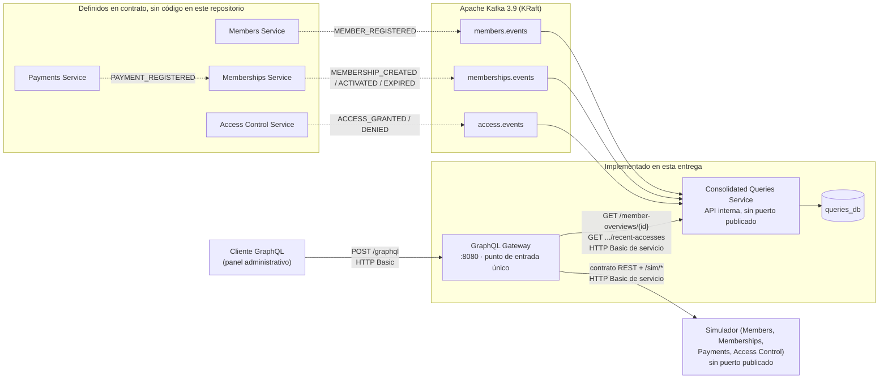
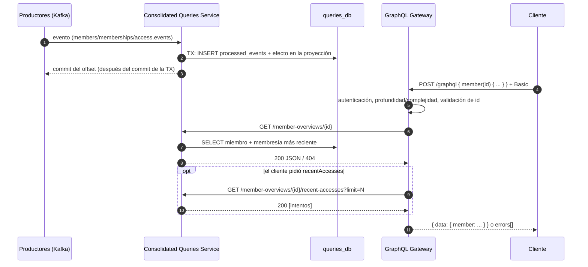
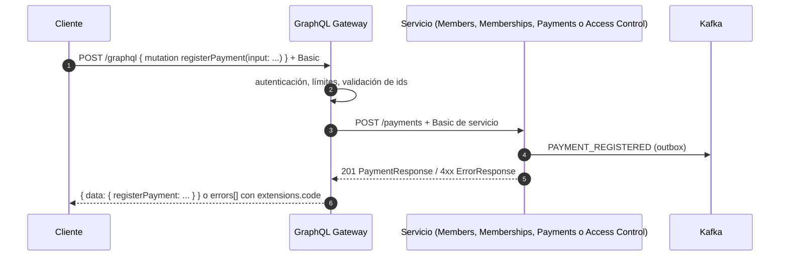

# API Gateway GraphQL y Consolidated Queries Service

Documento técnico de la implementación del gateway GraphQL y del servicio de consultas que alimenta la vista consolidada (RF-10). Fuente de verdad del alcance: `PA_G2_Equipo2_Entrega2P1.pdf` y `contracts/`.

> **Cambio respecto al PDF.** Por requerimiento posterior, el gateway dejó de ser de solo lectura: es el **punto de entrada único** de los clientes. Además de `member(id)`, expone como consultas y mutaciones GraphQL las operaciones del contrato REST, y las traduce a llamadas a Members, Memberships, Payments y Access Control. El PDF (§3.2, §7 y §11) todavía describe el gateway de solo lectura y debe actualizarse.

## 1. Arquitectura actual y arquitectura con gateway

En la Entrega 2 el repositorio solo contenía contratos e infraestructura (PostgreSQL y Kafka). Esta entrega añade dos aplicaciones ejecutables:

| Componente | Estado en este repositorio |
| --- | --- |
| GraphQL Gateway | **Implementado** (`gateways/graphql-gateway`) |
| Consolidated Queries Service | **Implementado** (`services/consolidated-queries-service`) |
| Members, Memberships, Payments y Access Control | Sin implementación Spring Boot; los cubre el simulador (`simulator/`) con el mismo contrato |



## 2. Responsabilidades

| Componente | Responsabilidad | No hace |
| --- | --- | --- |
| GraphQL Gateway | Punto de entrada único de los clientes; autenticación; validación de argumentos; límites de consulta; traducción de cada operación GraphQL a la llamada REST del servicio dueño; traducción de errores. | No tiene base de datos ni reglas de negocio, y no publica eventos: cada servicio valida sus comandos y publica sus eventos Kafka. |
| Consolidated Queries Service | Consume eventos, mantiene `MemberOverview` en `queries_db` de forma idempotente y lo expone por una API REST interna de lectura. | No decide accesos (RNF-06) ni llama a otros servicios. |

## 3. Flujo cliente → gateway → servicios



Las demás operaciones siguen el mismo camino hasta el gateway, que llama al servicio dueño del dato:



## 4. Organización del código

Ambos proyectos siguen la estructura interna del PDF (§9.1) como paquetes Java:

```text
gateways/graphql-gateway/src/main/java/co/edu/fet/gym/gateway/
  api/graphql/        resolvers (@QueryMapping, @MutationMapping, @SchemaMapping) y traducción de errores
  application/        validación de argumentos (MemberOverviewQueries, PlatformQueries, PlatformCommands)
  domain/             modelos y puertos ConsolidatedQueriesPort y GymPlatformPort
  infrastructure/     clientes HTTP, escalares, límites GraphQL y seguridad

services/consolidated-queries-service/src/main/java/co/edu/fet/gym/queries/
  api/                controlador REST y ErrorResponse
  application/        proyección idempotente y consultas
  domain/             eventos, modelo, regla de transición de membresía y puertos
  infrastructure/     Kafka (parser y listener), JDBC y seguridad
  resources/db/migration/V1__member_overview_projection.sql
```

En `consolidated-queries-service` se eliminaron las carpetas vacías `api/`, `application/`, `domain/`, `infrastructure/` y `tests/` de la raíz, porque ahora existen como paquetes del proyecto Maven. Estaban vacías y no se perdió ningún contenido.

## 5. Esquema GraphQL

El gateway **no mantiene una copia** del esquema: Maven copia `contracts/graphql/schema.graphqls` al classpath al compilar. Cualquier cambio en el contrato se refleja en el gateway, y un esquema que no encaje con los resolvers se detecta al arrancar.

- `Query.member(id: Int!): MemberOverview`: devuelve `null` si el miembro aún no está proyectado.
- `MemberOverview.member`, `.membership` (nullable) y `.recentAccesses(limit: Int = 10)`.
- Escalares `DateTime` (ISO 8601 con zona) y `Date` (`yyyy-MM-dd`), implementados en `IsoDateScalars`, y `JSON` (solo de salida, para el sobre de los eventos Kafka), en `JsonScalar`.

Operaciones que el gateway traduce a los servicios:

| Operación GraphQL | Llamada del gateway | Notas |
| --- | --- | --- |
| `members` | `GET /members` | |
| `plans` | `GET /plans` | |
| `memberships` | `GET /memberships` | |
| `membership(id)` | `GET /memberships/{id}` | `null` si no existe |
| `payments` | `GET /payments` | |
| `accessAttempts(limit = 50)` | `GET /sim/access-attempts?limit=` | `limit` entre 1 y 200 |
| `systemStatus` | lo arma el gateway: su propio estado, `GET /actuator/health` de Consolidated Queries y `GET /sim/status` (simulador, Kafka, PostgreSQL) | `UP` / `DOWN` / `UNKNOWN` por componente; nunca falla: un componente que no responde queda `DOWN` y lo que solo él informa, `UNKNOWN` |
| `kafkaEvents(after = 0, limit = 200)` | `GET /sim/events?after=&limit=` | `payload` es el sobre del evento como `JSON`; `limit` entre 1 y 500 |
| `registerMember(input)` | `POST /members` | publica `MEMBER_REGISTERED` |
| `createPlan(input)` | `POST /plans` | |
| `createMembership(input)` | `POST /memberships` | membresía `PENDING`; publica `MEMBERSHIP_CREATED` |
| `registerPayment(input)` | `POST /payments` | publica `PAYMENT_REGISTERED`; la activación sigue siendo asíncrona |
| `registerAccessAttempt(memberId)` | `POST /access-attempts` | Access Control decide con su estado local |
| `expireMembership(id)` | `POST /sim/memberships/{id}/expire` | demostración de RF-07 |

Las rutas `/sim/*` son extensiones del simulador fuera del contrato OpenAPI (ver `simulator/README.md`).

## 6. Consultas disponibles y ejemplos reales

Ejemplos ejecutados contra el stack de Compose (salida real recortada):

```bash
curl -s -u admin:<clave> -H 'Content-Type: application/json' http://localhost:8080/graphql \
  -d '{"query":"{ member(id: 1287054001) { member { name email } membership { status startDate endDate } recentAccesses(limit: 2) { attemptId result reason occurredAt } } }"}'
```

```json
{"data":{"member":{
  "member":{"name":"Ana Ruiz","email":"ana@example.com"},
  "membership":{"status":"ACTIVE","startDate":"2026-10-01","endDate":"2026-10-31"},
  "recentAccesses":[
    {"attemptId":1287054004,"result":"ACCESS_GRANTED","reason":"MEMBERSHIP_ACTIVE","occurredAt":"2026-10-02T12:00:00Z"},
    {"attemptId":1287054003,"result":"ACCESS_DENIED","reason":"NO_ACTIVE_MEMBERSHIP","occurredAt":"2026-10-01T07:00:00Z"}]}}}
```

Errores (`errors[0].extensions.classification`):

| Situación | Resultado |
| --- | --- |
| Miembro sin proyección o membresía inexistente | `null`, sin errores |
| Id `< 1` o `limit` fuera de rango | `BAD_REQUEST` (sin llamar al servicio) |
| Tipo incorrecto o campo inexistente | `ValidationError` |
| Profundidad > 15 o complejidad > 60 | error de instrumentación, sin ejecutar la consulta |
| El servicio rechaza un comando con 400 o 422 (datos inválidos, monto menor que el plan...) | `BAD_REQUEST`, con el código del servicio en `extensions.code` y su mensaje |
| El servicio responde 404 (miembro, plan o membresía inexistente) | `NOT_FOUND`, con `extensions.code` |
| El servicio responde 409 (documento repetido, membresía abierta, pago repetido...) | `CONFLICT`, con `extensions.code` |
| Servicio caído, rechaza la conexión, no conecta, está arrancando o responde 5xx | `UPSTREAM_UNAVAILABLE`, con `extensions.upstream` (`GYM_PLATFORM` o `CONSOLIDATED_QUERIES`) y, si el servicio lo explicó, `extensions.code` (`STARTING`, `DATABASE_UNAVAILABLE`) |
| El servicio lleva 5 fallos seguidos sin responder (disyuntor abierto) | `UPSTREAM_UNAVAILABLE` con `extensions.code = CIRCUIT_OPEN`, sin llamar al servicio |
| El servicio no responde dentro del timeout de lectura | `UPSTREAM_TIMEOUT`, con `extensions.upstream` |
| Error inesperado (credencial interna errónea, ruta inexistente, respuesta fuera de contrato) | `INTERNAL_ERROR` con mensaje genérico; el detalle va al log |

Ejemplo de rechazo de un comando:

```json
{"errors":[{"message":"Ya existe un miembro con el documento 1075000222.","path":["registerMember"],
  "extensions":{"code":"DOCUMENT_ALREADY_REGISTERED","classification":"CONFLICT"}}],"data":null}
```

Los mensajes de error no exponen hosts, puertos ni trazas. Solo se reenvían los mensajes de los rechazos de dominio, que los servicios redactan para el usuario. De un 5xx solo se reenvía el código si tiene forma de constante (`[A-Z][A-Z0-9_]+`), nunca texto libre del servicio.

### Tolerancia a fallos en el gateway

Toda llamada a un servicio pasa por `infrastructure/client/UpstreamCalls`:

- **Timeouts** de conexión y lectura por servicio (sección 7).
- **Reintento** único, tras 150 ms, de las lecturas (GET) cuando la conexión falla antes de obtener respuesta (por ejemplo, una conexión reutilizada que el servicio ya cerró). Los comandos (POST) nunca se reintentan: el servicio pudo aplicarlos aunque la respuesta se perdiera. Los timeouts y los 5xx tampoco se reintentan.
- **Disyuntor** (`CircuitBreaker`) por servicio: tras 5 fallos seguidos en los que el servicio no respondió (conexión rechazada o timeout) queda abierto 5 s y las llamadas fallan al instante con `CIRCUIT_OPEN`; luego deja pasar una llamada de prueba y se cierra si responde. Una respuesta del servicio, aunque sea 4xx o 5xx, demuestra que está vivo y no abre el circuito.

Escenarios completos (qué ve el usuario y cómo se recupera): `docs/tolerancia-a-fallos.md`.

## 7. Configuración y variables de entorno

Las credenciales **no tienen valor por defecto**: si faltan o tienen menos de 12 caracteres, la aplicación no arranca. Se definen en `infrastructure/.env` (copiar de `.env.example`; está en `.gitignore`).

| Variable | Servicio | Por defecto | Uso |
| --- | --- | --- | --- |
| `GATEWAY_CLIENT_USERNAME` / `GATEWAY_CLIENT_PASSWORD` | gateway | — | HTTP Basic de los clientes GraphQL |
| `QUERIES_API_USERNAME` / `QUERIES_API_PASSWORD` | ambos | — | Credencial interna gateway → servicio de consultas |
| `QUERIES_DB_USERNAME` / `QUERIES_DB_PASSWORD` | queries | — | Acceso a `queries_db` |
| `QUERIES_DB_URL` | queries | `jdbc:postgresql://localhost:5432/queries_db` | |
| `KAFKA_BOOTSTRAP_SERVERS` | queries | `localhost:9092` | En Compose: `kafka:29092` |
| `CONSOLIDATED_QUERIES_BASE_URL` | gateway | `http://localhost:8085` | |
| `CONSOLIDATED_QUERIES_CONNECT_TIMEOUT` / `_READ_TIMEOUT` | gateway | `2s` / `3s` | |
| `GYM_PLATFORM_BASE_URL` | gateway | `http://localhost:8090` | Members, Memberships, Payments y Access Control. En Compose: `http://services-simulator:8090` |
| `GYM_PLATFORM_USERNAME` / `GYM_PLATFORM_PASSWORD` | gateway | — | Credencial administrativa de esos servicios. En Compose se toma de `GATEWAY_CLIENT_*`, la que exige el simulador |
| `GYM_PLATFORM_CONNECT_TIMEOUT` / `_READ_TIMEOUT` | gateway | `2s` / `5s` | |
| `GATEWAY_CORS_ALLOWED_ORIGINS` | gateway | vacío (ningún origen) | Lista separada por comas |
| `GATEWAY_MAX_QUERY_DEPTH` / `GATEWAY_MAX_QUERY_COMPLEXITY` | gateway | `15` / `60` (la introspección no cuenta en la complejidad) | |
| `GATEWAY_SPRING_PROFILES_ACTIVE` | gateway (Compose) | `default` | `local` habilita GraphiQL; solo en desarrollo local |
| `GATEWAY_INTROSPECTION_ENABLED` | gateway | `true` | |

Puertos: gateway `8080`, el único servicio con puerto publicado para clientes. El servicio de consultas escucha en `8085` solo dentro de la red de Docker (no se publica): todo cliente entra por el gateway.

## 8. Cómo levantar el sistema

Requisitos: Docker con Compose. Para compilar y probar fuera de Docker: JDK 17 o superior (Maven lo descarga el wrapper `./mvnw`).

```bash
cd infrastructure
cp .env.example .env                           # y cambie las claves
docker compose --profile apps up -d --build --wait
./scripts/smoke-test-gateway.sh                # prueba E2E (requiere curl, jq y python3)
docker compose --profile apps down             # detener (conserva el volumen de datos)
```

`docker compose up -d` sin perfil sigue levantando solo PostgreSQL y Kafka, como en la entrega anterior.

### GraphiQL (solo desarrollo local)

GraphiQL está desactivado por defecto. Se habilita únicamente con el perfil Spring `local` (`application-local.yml`):

```bash
# infrastructure/.env
GATEWAY_SPRING_PROFILES_ACTIVE=local
# reconstruir/reiniciar solo el gateway
docker compose --profile apps up -d --build --no-deps --wait graphql-gateway
```

Abra `http://localhost:8080/graphiql` en Chrome. Ingrese `GATEWAY_CLIENT_USERNAME` y `GATEWAY_CLIENT_PASSWORD` en el diálogo HTTP Basic del navegador; Chrome reutiliza esa credencial en `/graphql`. Consulta de ejemplo:

```graphql
query MemberOverview {
  member(id: 1287453001) {
    member { id document name phone email createdAt }
    membership { id planId status startDate endDate createdAt }
    recentAccesses(limit: 5) { attemptId result reason occurredAt }
  }
}
```

Seguridad:

- La página exige HTTP Basic (401 sin credenciales) y solo admite un endpoint del mismo origen.
- Carga GraphiQL 5.2.4, React 19.2.7 y graphql 17.0.2 desde `esm.sh`, con versiones fijadas e `integrity` SRI en los módulos principales. Los módulos secundarios y los workers del editor no tienen SRI: por eso GraphiQL no se habilita fuera del entorno local.
- **No escriba credenciales en el panel _Headers_**: la página las guarda en el `localStorage` del navegador (`shouldPersistHeaders`). Use el diálogo Basic del navegador.
- En la consola aparece `module "@emotion/is-prop-valid" not found`. Viene de la página que trae Spring for GraphQL 2.0.6 y no afecta al funcionamiento. El 404 de `/favicon.ico` es esperado.

Ejecución local sin Docker para las aplicaciones (con la infraestructura de Compose levantada):

```bash
set -a; source infrastructure/.env; set +a
(cd services/consolidated-queries-service && ./mvnw spring-boot:run)
(cd gateways/graphql-gateway && ./mvnw spring-boot:run)
```

## 9. Pruebas realizadas y resultados (29-10-2026)

| Nivel | Comando | Resultado |
| --- | --- | --- |
| Unitarias: dominio y parser de eventos (incluye regresiones de la revisión: NUL, años fuera de rango, orden EXPIRED/ACTIVATED) | `cd services/consolidated-queries-service && ./mvnw test` | 18/18 |
| Integración real: Testcontainers PostgreSQL 16 + Kafka 3.9.1, eventos en Kafka y verificación por HTTP | (misma suite) | 6/6 |
| Cliente HTTP del gateway contra un servidor HTTP real (stub): mapeo, 404, 5xx, 401, timeout con cuerpo detenido, conexión rechazada, 404 sin MEMBER_NOT_FOUND, Basic en UTF-8 | `cd gateways/graphql-gateway && ./mvnw test` | 11/11 |
| Cliente HTTP de la plataforma contra un stub (05-11-2026): listas, cuerpo de los comandos, `paidAt` con zona, rechazo con código, 404 de recurso frente a ruta inexistente, POST sin cuerpo, estado y visor de Kafka, 503 y 401 | (misma suite) | 9/9 |
| Gateway completo por HTTP con los puertos simulados (mock): resolvers, mutaciones e inputs, escalares (incluido `JSON`), validación, rechazos con `extensions.code`, errores, límites, introspección, seguridad y CORS (05-11-2026) | (misma suite) | 15/15 |
| GraphiQL con el perfil `local`: exige Basic, redirección al mismo origen, página con SRI y cabeceras anti-clickjacking | (misma suite) | 3/3 |
| GraphiQL en Chrome 156 (puppeteer-core sobre el Chrome instalado): esquema cargado y `member(id: 1287453001)` ejecutado desde el editor | manual | correcto |
| **E2E real**: Kafka → Queries Service → PostgreSQL → Gateway, incluidos duplicado, evento inválido, caída y recuperación | `infrastructure/scripts/smoke-test-gateway.sh` | 18/18 |
| Disyuntor, reintento de lecturas, estado armado por el gateway (incluso con todos los servicios caídos), `extensions.upstream` y `extensions.code` (11-11-2026) | `cd gateways/graphql-gateway && ./mvnw test` | 49/49 |
| **Entrada única y caídas reales** de simulador, PostgreSQL, Kafka, Consolidated Queries y gateway, con recuperación automática (11-11-2026) | `probar-fallos.bat` | 41/41 |

Las pruebas del gateway con mock **no** sustituyen la integración real; esta se demuestra con el script E2E sobre los contenedores. Los tests de integración usan `apache/kafka:3.9.1` porque el `KafkaContainer` de Testcontainers 2.0.5 no arranca con `3.9.0`: el formateo del almacenamiento rechaza `advertised.listeners` con `0.0.0.0`. El Compose sigue usando `3.9.0`.

## 10. Decisiones técnicas

| Decisión | Justificación |
| --- | --- |
| Spring Boot 4.1.2, Java 17, Spring for GraphQL | Stack declarado del proyecto (Spring Boot); línea con soporte vigente; Java 17 es el mínimo compatible. |
| Gateway como punto de entrada único, con mutaciones | Requerimiento posterior al PDF: todas las llamadas de los clientes pasan por el gateway. Las mutaciones solo traducen a la operación REST del servicio dueño; no hay lógica transaccional ni eventos en el gateway, así que se conservan RNF-01 a RNF-03. |
| Errores de dominio con el código del servicio en `extensions.code` | El panel distingue rechazos (por ejemplo `DOCUMENT_ALREADY_REGISTERED`) igual que con el `ErrorResponse` REST. |
| `systemStatus` armado por el gateway, no por un servicio | El gateway es el punto de entrada único: si el estado dependiera del simulador, al caerse este el panel no sabría qué falla. Así el simulador tampoco necesita conocer al gateway. |
| Disyuntor y reintento propios (sin Resilience4j) | Unas 100 líneas cubiertas por pruebas unitarias; no agrega dependencias ni configuración para un MVP con dos servicios aguas abajo. |
| `POST /access-attempts` autenticado a través del gateway | El contrato REST lo deja sin HTTP Basic porque representa al torniquete. El gateway exige credencial en todas sus operaciones; el torniquete real podría seguir llamando al servicio directamente. |
| Gateway → Queries Service por REST interno (contrato `contracts/openapi/consolidated-queries-api.yaml`) | El PDF fija que el gateway consulta al servicio de queries y que nadie accede a la base de otro servicio. |
| Resolución por campo de `recentAccesses` | Solo se llama al servicio si el cliente pide ese campo. No hay N+1 porque la raíz devuelve un único objeto. |
| Esquema tomado del contrato al compilar | Evita que la copia y el contrato diverjan. |
| Inbox `processed_events` en la misma transacción que la proyección; ack-mode `RECORD` | Implementa RNF-09 y events.yaml: el offset se confirma después del commit. |
| El estado de membresía solo avanza (PENDING → ACTIVE → EXPIRED); la membresía no se expone hasta recibir MEMBERSHIP_CREATED | El contrato no fija clave de partición: los eventos pueden llegar desordenados y la proyección debe converger. |
| Membresía mostrada: la más reciente por `createdAt` (a igualdad, mayor id) | El contrato expone una sola `membership` por miembro. **Validar con el equipo.** |
| `createdAt` de la membresía y `occurredAt` del acceso se toman del sobre del evento | MEMBERSHIP_CREATED y ACCESS_* no traen esos campos de dominio. |
| Errores de Kafka: reintento exponencial sin límite (1 s → 30 s) para fallos transitorios; eventos inválidos se registran en ERROR y se descartan | Provisional mientras se definen reintentos y DLT (pendiente del PDF). No pierde eventos válidos ni bloquea por mensajes corruptos. |
| HTTP Basic en gateway y servicio, con credencial de servicio propia | RNF-07 (Basic inicial). El contrato no define roles: basta con estar autenticado. |
| Límite de `recentAccesses`: 1..50 | El contrato no define un máximo; se acota para evitar consultas abusivas. |
| Flyway con `baseline-on-migrate` (versión 0) | El volumen local existente ya tenía una tabla ajena (`received_events`) en `queries_db`; así se migra sin tocarla. |

## 11. Limitaciones y pendientes

- **Productores sin implementar en este repositorio**: la integración se demuestra publicando en Kafka eventos conformes al contrato. El volumen local contiene eventos de 2026-10-04 escritos por `members-service`, `memberships-service`, `payments-service` y `access-control-service` (tabla `received_events`), lo que indica que existen implementaciones **fuera de este repositorio**. Conviene integrarlas.
- **GraphQL `Int` es de 32 bits y los contratos REST y Kafka usan `int64`**: un id mayor que 2 147 483 647 producirá un error de serialización en el gateway. Se reporta y no se corrige, porque cambiar el contrato no está en el alcance.
- Todos los servicios usan el superusuario `gym_user` de PostgreSQL; falta un rol por base (mínimo privilegio).
- Sin limitación de intentos (rate limiting) contra fuerza bruta en HTTP Basic; el mecanismo definitivo de autenticación sigue pendiente (PDF §11.2).
- Estrategia definitiva de reintentos, mensajes no procesables y dead-letter topics: pendiente del equipo.
- Formato común de trazas y correlación: pendiente (PDF §11.2).
