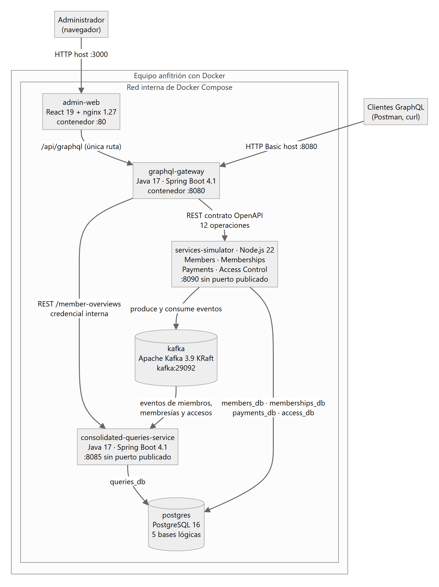
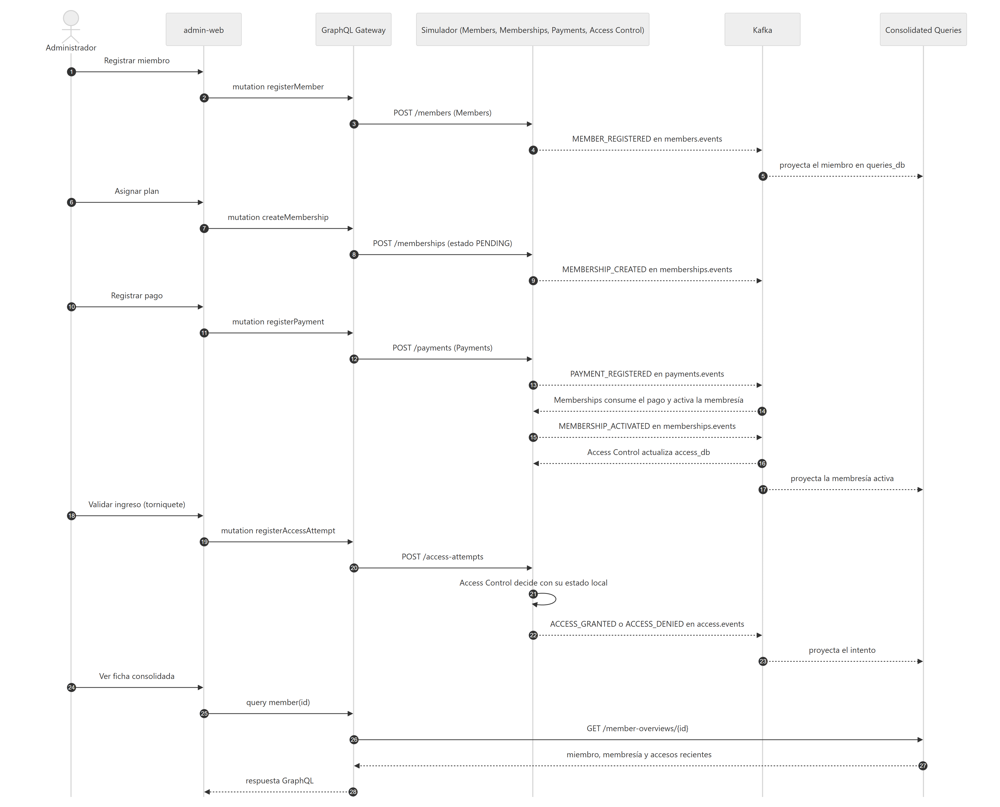
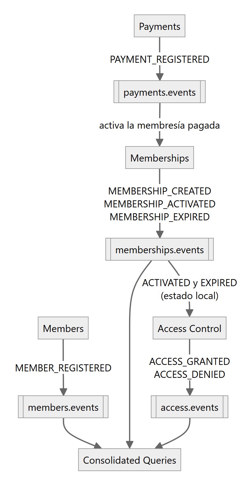
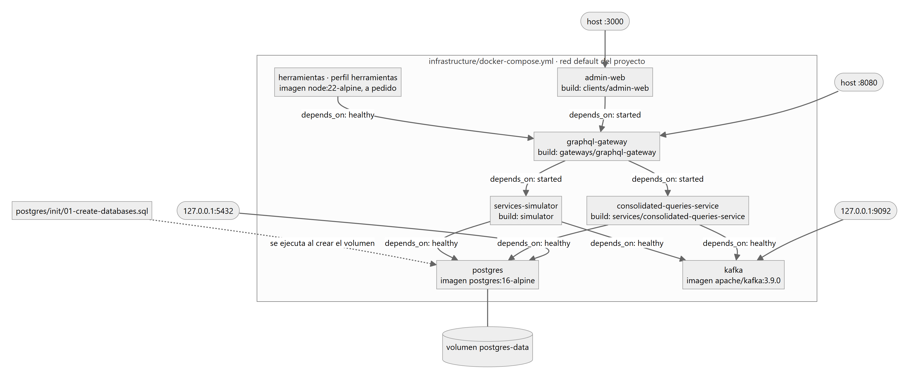
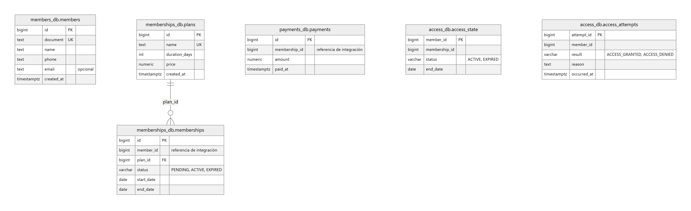
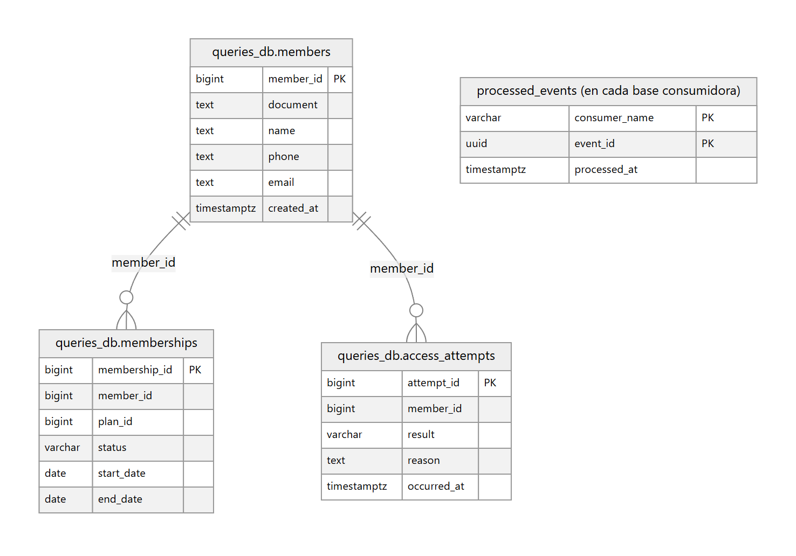

# Arquitectura: componentes, responsabilidades y comunicación

Este documento describe la arquitectura **aprobada en la Entrega 2 y efectivamente implementada** en este repositorio, y señala qué partes están simuladas o pendientes. Las fuentes de los diagramas están en [`diagramas/`](diagramas/) (formato Mermaid, `.mmd`) junto con su versión en imagen (`.png` y `.svg`).

## 1. Estado de cada componente

| Componente | Estado | Tecnología | Dónde está |
| --- | --- | --- | --- |
| Panel administrativo (`admin-web`) | **Implementado** | React 19, TypeScript, Vite 8, nginx 1.27 | `clients/admin-web/` |
| Simulador del torniquete | **Implementado** como la pantalla *Control de acceso* del panel | React | `clients/admin-web/src/pages/Access.tsx` |
| GraphQL Gateway | **Implementado** | Java 17, Spring Boot 4.1.2, Spring for GraphQL | `gateways/graphql-gateway/` |
| Consolidated Queries Service | **Implementado** | Java 17, Spring Boot 4.1.2, Flyway, Spring Kafka | `services/consolidated-queries-service/` |
| Members, Memberships, Payments y Access Control | **Simulados** por un servicio Node.js que cumple los mismos contratos REST y Kafka | Node.js 22, Express 5, kafkajs, pg | `simulator/` |
| Servicios Spring Boot de Members, Memberships, Payments y Access Control | **Pendientes** (solo estructura de carpetas) | — | `services/*-service/` |
| PostgreSQL | **Implementado** (cinco bases lógicas) | PostgreSQL 16 Alpine | `infrastructure/` |
| Apache Kafka | **Implementado** (broker único KRaft) | Apache Kafka 3.9.0 | `infrastructure/` |

El simulador se puede retirar sin tocar el gateway ni el panel: basta con apuntar `GYM_PLATFORM_BASE_URL` del gateway a los servicios Spring Boot cuando existan.

## 2. Vista de componentes

- El **navegador** solo conoce el panel (`:3000`). nginx sirve la aplicación React y reenvía al gateway **una única ruta**, `/api/graphql`; cualquier otra ruta `/api/*` responde 404.
- El **GraphQL Gateway** (`:8080`) es el punto de entrada único. Exige HTTP Basic, resuelve `member(id)` contra Consolidated Queries y el resto de consultas y mutaciones contra el contrato REST de los servicios de dominio.
- **Consolidated Queries** y el **simulador** no publican puertos: solo los alcanza el gateway dentro de la red de Docker.
- **PostgreSQL** y **Kafka** se publican únicamente en `127.0.0.1` del equipo anfitrión, para herramientas de desarrollo.

## 3. Responsabilidades

| Componente | Responsabilidad | Persistencia | Produce | Consume |
| --- | --- | --- | --- | --- |
| Panel administrativo | Interfaz del administrador: miembros, planes, membresías, pagos, torniquete, recorrido guiado, eventos y estado del sistema | — | — | — |
| GraphQL Gateway | Entrada única, autenticación, validación de argumentos, límites de profundidad y complejidad, traducción a REST, tiempos de espera, reintentos de lectura, disyuntor por servicio y estado del sistema | — | — | — |
| Members | Registrar y consultar miembros | `members_db` | `MEMBER_REGISTERED` | — |
| Memberships | Planes, membresías, activación y vencimiento programado | `memberships_db` | `MEMBERSHIP_CREATED`, `MEMBERSHIP_ACTIVATED`, `MEMBERSHIP_EXPIRED` | `PAYMENT_REGISTERED` |
| Payments | Registrar pagos administrativos | `payments_db` | `PAYMENT_REGISTERED` | — |
| Access Control | Decidir el ingreso **solo con su estado local** y registrar cada intento | `access_db` | `ACCESS_GRANTED`, `ACCESS_DENIED` | `MEMBERSHIP_ACTIVATED`, `MEMBERSHIP_EXPIRED` |
| Consolidated Queries | Mantener la vista de lectura `MemberOverview` (miembro, membresía y accesos recientes) | `queries_db` | — | `MEMBER_REGISTERED`, eventos de membresía y de acceso |

Ningún servicio accede a la base de otro. Los identificadores que cruzan dominios (`member_id`, `membership_id`) son referencias de integración, no claves foráneas.

## 4. Comunicación entre componentes

| Origen → destino | Protocolo | Autenticación | Contrato |
| --- | --- | --- | --- |
| Navegador → panel | HTTP | — | — |
| Panel → gateway | HTTP POST `/api/graphql` (reenviado por nginx) | HTTP Basic del usuario | [`contracts/graphql/schema.graphqls`](../contracts/graphql/schema.graphqls) |
| Clientes externos → gateway | HTTP POST `:8080/graphql` | HTTP Basic | mismo esquema GraphQL |
| Gateway → Members, Memberships, Payments, Access Control | REST síncrono | HTTP Basic administrativa (excepto `POST /access-attempts`) | [`contracts/openapi/gym-platform-api.yaml`](../contracts/openapi/gym-platform-api.yaml) |
| Gateway → Consolidated Queries | REST síncrono | HTTP Basic interna | [`contracts/openapi/consolidated-queries-api.yaml`](../contracts/openapi/consolidated-queries-api.yaml) |
| Servicios ↔ Kafka | Eventos asíncronos, entrega de al menos una vez | — | [`contracts/kafka/events.yaml`](../contracts/kafka/events.yaml) |
| Servicios → PostgreSQL | JDBC / `pg` | usuario local `gym_user` | migraciones de cada servicio |

### Flujo principal

La activación de la membresía y la decisión de acceso no dependen de llamadas síncronas entre servicios: viajan como eventos por Kafka. Por eso la vista consolidada tiene **consistencia eventual** y nunca se usa para autorizar un ingreso.

### Tópicos y eventos de Kafka

| Tópico | Productor | Consumidores | Eventos |
| --- | --- | --- | --- |
| `members.events` | Members | Consolidated Queries | `MEMBER_REGISTERED` |
| `payments.events` | Payments | Memberships | `PAYMENT_REGISTERED` |
| `memberships.events` | Memberships | Access Control y Consolidated Queries | `MEMBERSHIP_CREATED`, `MEMBERSHIP_ACTIVATED`, `MEMBERSHIP_EXPIRED` |
| `access.events` | Access Control | Consolidated Queries | `ACCESS_GRANTED`, `ACCESS_DENIED` |

Todos los eventos comparten el sobre `eventId`, `eventType`, `occurredAt` y `version`. Cada consumidor guarda el `eventId` en `processed_events` en la misma transacción que su efecto, de modo que un evento duplicado no se aplica dos veces. Los productores usan un **outbox transaccional**: si Kafka no está disponible, el evento queda guardado y se publica cuando vuelve.

## 5. Despliegue con Docker Compose

| Servicio | Imagen o construcción | Puerto en el equipo | Depende de | Healthcheck |
| --- | --- | --- | --- | --- |
| `postgres` | `postgres:16-alpine` | `127.0.0.1:5432` | — | `pg_isready` |
| `kafka` | `apache/kafka:3.9.0` | `127.0.0.1:9092` | — | `kafka-broker-api-versions.sh` |
| `consolidated-queries-service` | `services/consolidated-queries-service/Dockerfile` | ninguno | postgres y kafka saludables | `/actuator/health/readiness` |
| `services-simulator` | `simulator/Dockerfile` | ninguno | postgres y kafka saludables | `/health` |
| `graphql-gateway` | `gateways/graphql-gateway/Dockerfile` | `8080` | queries y simulador iniciados | `/actuator/health/readiness` |
| `admin-web` | `clients/admin-web/Dockerfile` | `3000` | gateway iniciado | `/healthz` |
| `herramientas` (perfil `herramientas`) | `node:22-alpine` | ninguno | gateway saludable | — (se ejecuta a pedido) |

- **Red:** todos los servicios comparten la red por defecto del proyecto de Compose; se encuentran por nombre (`kafka:29092`, `postgres:5432`, `graphql-gateway:8080`).
- **Volumen:** `postgres-data` conserva las cinco bases entre reinicios. `borrar-datos` lo elimina.
- **Inicialización:** `infrastructure/postgres/init/01-create-databases.sql` crea las cinco bases la primera vez que se crea el volumen.
- **Reinicio:** todos los servicios usan `restart: unless-stopped`.
- **Perfiles:** `apps` agrupa las aplicaciones y `herramientas` el contenedor de datos ficticios y mediciones.

## 6. Modelo de datos

Bases de los servicios de dominio (hoy, el simulador; esquema `simulator` de cada base):

Vista consolidada (`queries_db`, migración Flyway) y tabla de idempotencia presente en cada base consumidora:

Cada base productora tiene además una tabla `outbox` con los eventos pendientes de publicar. Detalle de las migraciones en el [manual técnico](manual-tecnico.md#4-bases-de-datos-y-migraciones).

## 7. Decisiones y límites de la arquitectura

- REST para comandos que necesitan confirmación inmediata; Kafka para propagar cambios; GraphQL como entrada única de los clientes.
- La implementación amplió el gateway con mutaciones (comandos) para que el panel no llame directamente a los servicios. El PDF de la Entrega 2 todavía lo describe como de solo lectura (secciones 3.2, 7 y 11).
- Infraestructura académica local: un solo broker de Kafka sin réplicas y credenciales de ejemplo.
- Pendientes: servicios Spring Boot de dominio, autenticación definitiva, política de reintentos y *dead-letter topics*, trazas distribuidas. Ver la sección de limitaciones del [README](../README.md#limitaciones-y-componentes-pendientes).
