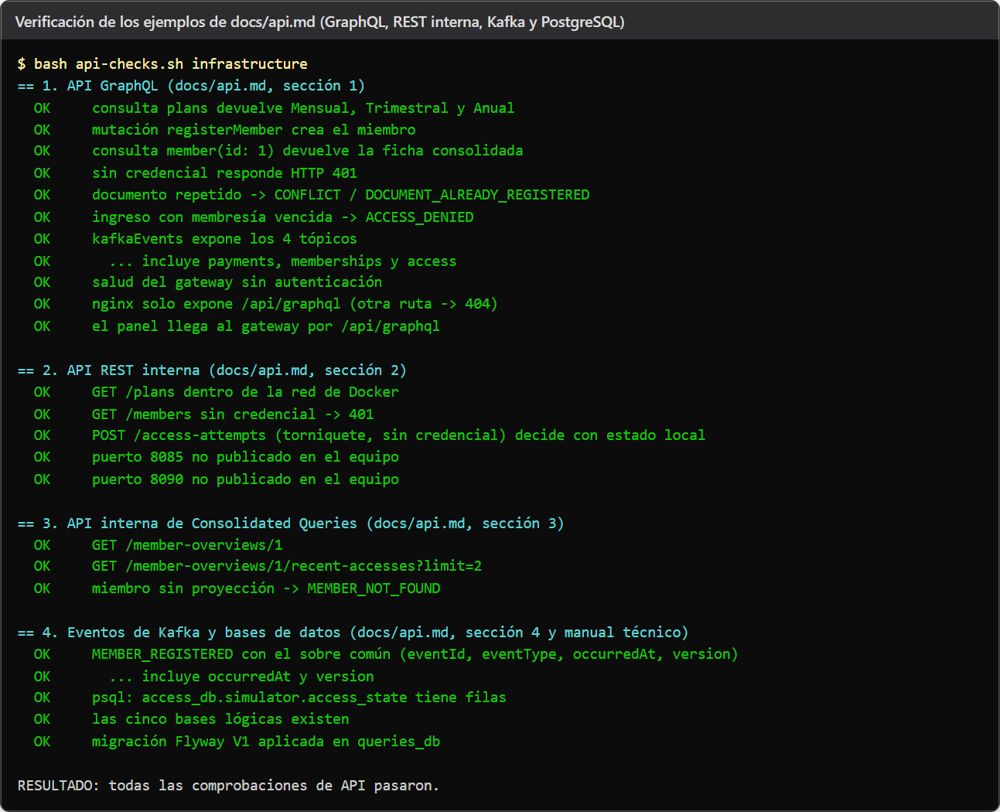
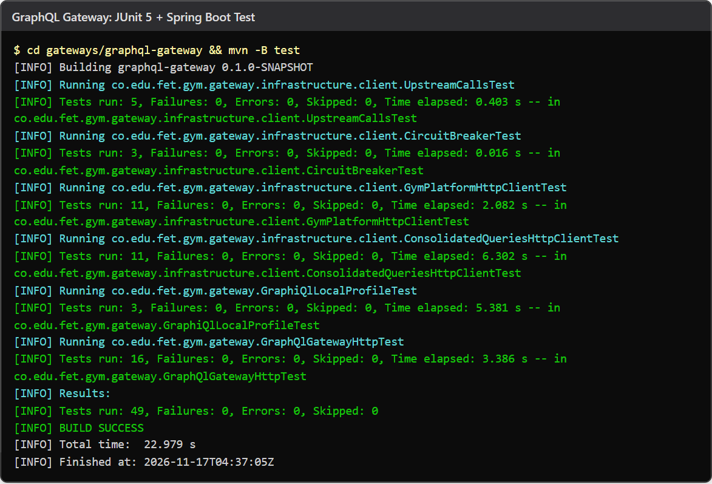
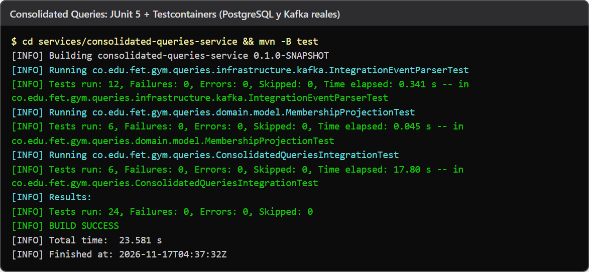
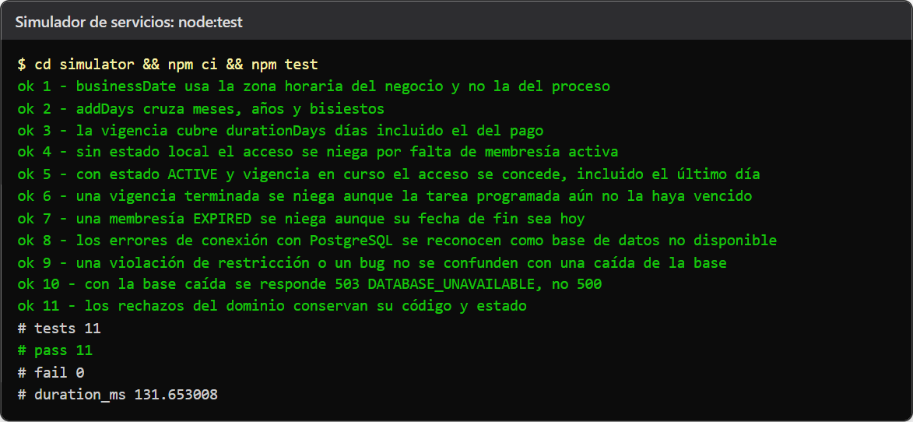
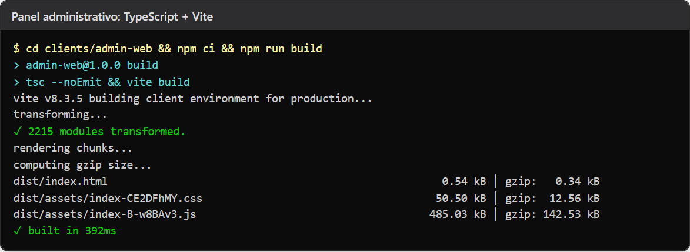
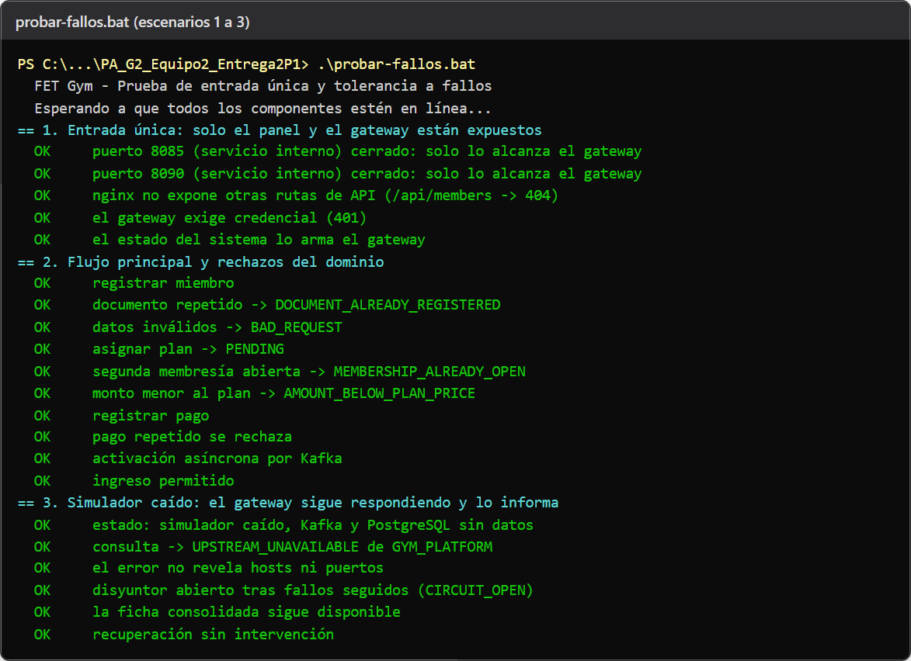
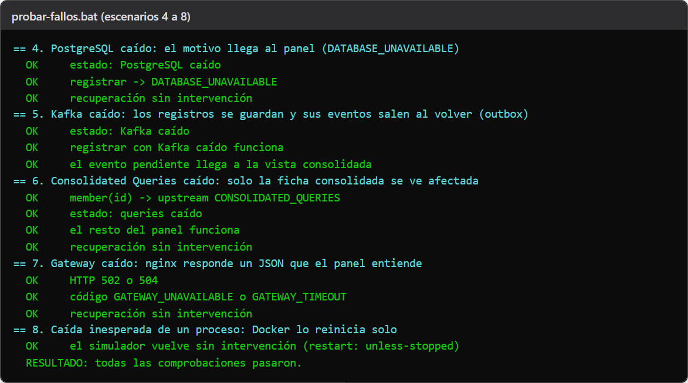
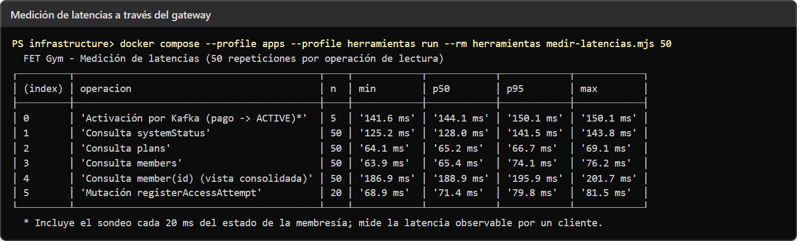
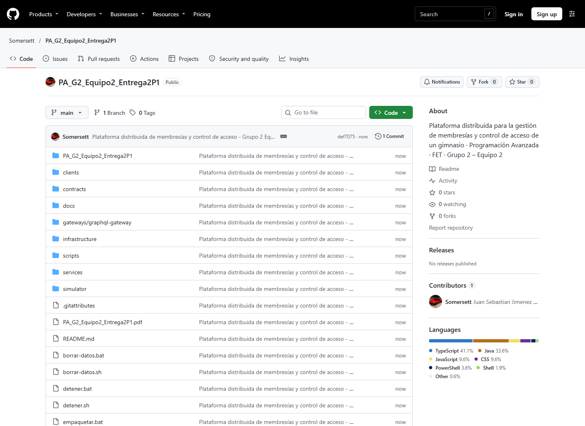

# Pruebas y evidencias

**Fecha de ejecución:** 16 de noviembre de 2026 · **Equipo:** Windows 11, AMD Ryzen 5 5600H, 31,3 GB de RAM, Docker 29.7.2 con Compose v5.5.1 · **Navegador:** Google Chrome 157 automatizado con Playwright.

**Cómo se probó.** Se generó el ZIP con `empaquetar.bat` (git archive del commit `8fe5864`), se extrajo en una carpeta nueva y se siguieron **solo** las instrucciones del README:

1. Las imágenes se construyeron sin caché (`--no-cache`).
2. Se ejecutó `iniciar.bat`, que creó `infrastructure/.env` desde `.env.example`.
3. Se cargaron los datos ficticios con `datos-demo.bat`.

Todas las pruebas de este documento se ejecutaron sobre esa instalación. Para no mezclarla con otra instalación del mismo equipo, se usó un nombre de proyecto de Compose propio (`COMPOSE_PROJECT_NAME`), con volúmenes vacíos, lo que equivale a un equipo nuevo.

Las versiones posteriores a ese commit solo agregan o corrigen documentación y evidencias; el código, los Dockerfiles y el Compose no cambian. Se puede comprobar con `git diff 8fe5864 -- . ':!docs' ':!README.md'`.

## 1. Tipos de resultado

| Marca | Significado |
| --- | --- |
| **M** (medido) | Resultado observado o medido en ejecución real sobre la plataforma desplegada: números, tiempos, códigos y respuestas reales |
| **S** (simulación) | La prueba pasa por un componente simulado: Members, Memberships, Payments y Access Control son un simulador Node.js que cumple sus contratos; el torniquete es una pantalla; las fallas se provocan deteniendo contenedores; los datos son ficticios |
| **F** (trabajo futuro) | Comportamiento previsto que **no** se probó en esta entrega; ver la sección 8 |

## 2. Resumen por nivel

| Nivel | Casos | Aprobados | Fallidos | Tipo | Evidencia |
| --- | ---: | ---: | ---: | --- | --- |
| Unitarias e integración, GraphQL Gateway (JUnit 5, Spring Boot Test) | 49 | 49 | 0 | M | [32](evidencias/32-consola-tests-gateway.png) |
| Unitarias e integración, Consolidated Queries (con PostgreSQL y Kafka reales vía Testcontainers) | 24 | 24 | 0 | M | [33](evidencias/33-consola-tests-queries.png) |
| Unitarias, simulador de servicios (`node:test`) | 11 | 11 | 0 | M, S | [34](evidencias/34-consola-tests-simulador.png) |
| Compilación del panel (TypeScript y Vite) | 1 | 1 | 0 | M | [35](evidencias/35-consola-build-panel.png) |
| Instalación desde el ZIP, despliegue y datos ficticios | 6 | 6 | 0 | M | sección 3.1 |
| Casos funcionales (flujo principal, control de acceso, módulos, validaciones y fallas en el panel) | 28 | 28 | 0 | M, S | secciones 3.2 a 3.6 |
| Integración de servicios y APIs (GraphQL, REST, Kafka, PostgreSQL) | 25 | 25 | 0 | M, S | sección 4 |
| Entrada única y tolerancia a fallos de extremo a extremo (`probar-fallos`) | 35 | 35 | 0 | M, S | sección 6 |
| **Total** | **179** | **179** | **0** | | |

## 3. Matriz de pruebas

### 3.1 Instalación y despliegue

| ID | Caso | Resultado esperado | Resultado obtenido | Estado | Evidencia |
| --- | --- | --- | --- | --- | --- |
| INS-01 | Construir las imágenes desde el ZIP sin caché | Las cuatro imágenes propias se construyen sin errores | 4 imágenes construidas en 1 min 46 s (con las imágenes base ya descargadas) | Aprobado | registro de construcción |
| INS-02 | Ejecutar `iniciar.bat` en la carpeta extraída | Crea `.env`, revisa puertos y deja todo saludable | `.env` creado desde `.env.example`; 6 contenedores *healthy*; “Todo está en marcha” en 23 s | Aprobado | [30](evidencias/30-consola-iniciar.png) |
| INS-03 | Puertos expuestos | Solo 3000 y 8080 públicos; 5432 y 9092 en 127.0.0.1; 8085 y 8090 sin publicar | Coincide con lo esperado | Aprobado | [31](evidencias/31-consola-compose-ps.png) |
| INS-04 | Cargar datos ficticios con `datos-demo.bat` | 8 miembros con sus escenarios de membresía e ingreso | 4 activas (ingresos permitidos), 2 pendientes, 1 vencida y 1 sin membresía (ingresos denegados) | Aprobado | [38](evidencias/38-consola-datos-demo.png) |
| INS-05 | Repetir la carga con `bash datos-demo.sh` (Git Bash) | No duplica datos | “0 miembros nuevos, 8 ya existían” | Aprobado | registro de ejecución |
| INS-06 | Sintaxis y finales de línea de los `.sh` del ZIP | `bash -n` sin errores y finales LF | 5 de 5 scripts correctos | Aprobado | registro de ejecución |

### 3.2 Flujo principal (recorrido guiado)

| ID | Caso | Resultado esperado | Resultado obtenido | Estado | Evidencia |
| --- | --- | --- | --- | --- | --- |
| FP-01 | Ingresar con la credencial de `.env` | Acceso al tablero | Tablero con indicadores y 5 de 5 componentes en línea | Aprobado | [01](evidencias/01-login.png), [03](evidencias/03-inicio.png) |
| FP-02 | Ingresar con contraseña incorrecta | Rechazo con explicación | “No se pudo ingresar. Usuario o contraseña incorrectos.” e indica dónde está la clave | Aprobado | [02](evidencias/02-login-error.png) |
| FP-03 | Registrar miembro (RF-01) | Miembro creado y `MEMBER_REGISTERED` publicado | Miembro #9 creado; evento en `members.events` a las 23:41:38 | Aprobado | [04](evidencias/04-recorrido-paso1-miembro.png), [05](evidencias/05-recorrido-paso2-plan.png) |
| FP-04 | Asignar plan (RF-04) | Membresía `PENDING` y `MEMBERSHIP_CREATED` | Membresía #8 pendiente de pago; evento a las 23:41:41 | Aprobado | [06](evidencias/06-recorrido-paso3-pago.png) |
| FP-05 | Registrar pago (RF-05) | Pago guardado y `PAYMENT_REGISTERED` | Pago #6 por $90.000; evento a las 23:41:44 | Aprobado | [07](evidencias/07-recorrido-paso3-activacion.png) |
| FP-06 | Activación automática por Kafka (RF-06) | Membresía `ACTIVE` sin intervención | `MEMBERSHIP_ACTIVATED` en el mismo segundo (23:41:44); vigencia 16-11-2026 a 15-12-2026 | Aprobado | [07](evidencias/07-recorrido-paso3-activacion.png) |
| FP-07 | Validar ingreso con membresía activa (RF-08) | `ACCESS_GRANTED` | Ingreso permitido; `ACCESS_GRANTED` a las 23:41:48 | Aprobado | [08](evidencias/08-recorrido-paso4-ingreso.png) |
| FP-08 | Consultar la ficha consolidada (RF-10) | `member(id)` con miembro, membresía y accesos | Respuesta real del gateway en 242 ms con los tres bloques | Aprobado | [09](evidencias/09-recorrido-paso5-ficha.png) |
| FP-09 | Cerrar el recorrido | Los nueve pasos del flujo verificados | 9 de 9 pasos marcados | Aprobado | [10](evidencias/10-recorrido-completo.png) |

### 3.3 Control de acceso

| ID | Caso | Resultado esperado | Resultado obtenido | Estado | Evidencia |
| --- | --- | --- | --- | --- | --- |
| AC-01 | Validar el ingreso de un miembro con membresía activa (Andrea Camila Perdomo Ríos) | Permitido | “Acceso permitido · Membresía activa” | Aprobado | [11](evidencias/11-control-acceso-permitido.png) |
| AC-02 | Validar el ingreso de un miembro con membresía vencida (Miguel Ángel Ramírez Silva) (RF-07, RF-08) | Denegado por vencimiento | “Acceso denegado · Membresía vencida”; `ACCESS_DENIED` con motivo `MEMBERSHIP_EXPIRED` | Aprobado | [12](evidencias/12-control-acceso-denegado.png) |
| AC-03 | Validar el ingreso de un miembro sin membresía (Laura Marcela Quintero Charry) | Denegado | `ACCESS_DENIED` | Aprobado | [38](evidencias/38-consola-datos-demo.png) |
| AC-04 | Registro de cada intento (RF-09) | Todos los intentos quedan en la lista, permitidos o no | Lista de intentos recientes con resultado, motivo y hora | Aprobado | [11](evidencias/11-control-acceso-permitido.png) |

### 3.4 Módulos administrativos

| ID | Caso | Resultado esperado | Resultado obtenido | Estado | Evidencia |
| --- | --- | --- | --- | --- | --- |
| ADM-01 | Listar miembros con filtros (RF-02) | Miembros con estado de membresía | 9 miembros con filtros por estado | Aprobado | [13](evidencias/13-miembros.png) |
| ADM-02 | Abrir la ficha de un miembro (RF-02, RF-10) | Membresía, datos y accesos recientes | Ficha de Andrea Camila Perdomo Ríos con membresía Mensual activa e ingresos permitidos | Aprobado | [14](evidencias/14-ficha-miembro.png) |
| ADM-03 | Listar membresías | Estados pendiente, activa y vencida con vigencia | Las 8 membresías con su estado | Aprobado | [15](evidencias/15-membresias.png) |
| ADM-04 | Listar pagos | Historial y total recaudado | 6 pagos y su total | Aprobado | [16](evidencias/16-pagos.png) |
| ADM-05 | Catálogo de planes (RF-03) | Planes con duración y precio | Mensual, Trimestral y Anual | Aprobado | [17](evidencias/17-planes.png) |
| ADM-06 | Visor de eventos de Kafka | Mensajes de los 4 tópicos con productor, consumidores y *offset* | Eventos del recorrido y de los datos ficticios en sus tópicos | Aprobado | [18](evidencias/18-eventos-kafka.png) |

### 3.5 Validaciones y rechazos del dominio

| ID | Caso | Resultado esperado | Resultado obtenido | Estado | Evidencia |
| --- | --- | --- | --- | --- | --- |
| VAL-01 | Registrar un documento existente | `DOCUMENT_ALREADY_REGISTERED` junto al campo | “Ya existe un miembro con el documento 1075900101…” | Aprobado | [19](evidencias/19-validacion-documento.png) |
| VAL-02 | Registrar datos con formato inválido | Mensajes por campo antes de enviar | “Escribe el nombre completo.”, “Entre 5 y 20 letras o números…”, “Solo números… entre 7 y 20 caracteres” | Aprobado | [20](evidencias/20-validacion-datos.png) |
| VAL-03 | Crear un plan con nombre existente | `PLAN_NAME_TAKEN` junto al campo | “Ya existe un plan llamado "Mensual"…” | Aprobado | [21](evidencias/21-validacion-plan-repetido.png) |
| VAL-04 | Registrar un pago menor al precio del plan | Rechazo junto al campo Monto | “Debe cubrir el valor del plan ($ 90.000).” | Aprobado | [22](evidencias/22-validacion-pago-monto.png) |

Los rechazos `MEMBERSHIP_ALREADY_OPEN`, `AMOUNT_BELOW_PLAN_PRICE` (en el servicio), pago repetido y `BAD_REQUEST` también se verificaron en el escenario 2 de `probar-fallos` (sección 6).

### 3.6 Tolerancia a fallos observada en el panel

| ID | Caso | Resultado esperado | Resultado obtenido | Estado | Evidencia |
| --- | --- | --- | --- | --- | --- |
| TF-01 | Detener el simulador | Aviso con la causa y qué se afecta; lista “no disponible”, no “vacía” | Aviso rojo “Simulador de servicios no responde” con las funciones afectadas y qué hacer | Aprobado | [23](evidencias/23-falla-simulador.png) |
| TF-02 | Volver a iniciarlo | Recuperación sin intervención | “El sistema volvió a estar en línea” y datos actualizados | Aprobado | [24](evidencias/24-recuperacion.png) |
| TF-03 | Detener Kafka | Aviso de funcionamiento parcial | Aviso amarillo: “Los registros se guardan, pero activaciones, ingresos y ficha consolidada se ponen al día cuando Kafka vuelva” | Aprobado | [25](evidencias/25-falla-kafka.png) |
| TF-04 | Detener Consolidated Queries | Solo la ficha consolidada se afecta | “La ficha consolidada no está disponible. El resto del panel funciona.” | Aprobado | [26](evidencias/26-falla-consultas.png) |
| TF-05 | Detener el GraphQL Gateway | El panel lo informa y reintenta | “El GraphQL Gateway no responde. Reintentando” y recuperación al volver | Aprobado | [27](evidencias/27-falla-gateway.png) |

## 4. Integración de servicios y APIs

Se ejecutaron literalmente los ejemplos de [`api.md`](api.md) con curl desde Git Bash y desde el contenedor del gateway (servicios sin puerto publicado). Resultado: 24 de 24 comprobaciones, más el ejemplo de PowerShell (`gateway=UP simulator=UP queries=UP kafka=UP postgres=UP`).

| Integración | Comprobación | Resultado obtenido | Tipo |
| --- | --- | --- | --- |
| Cliente → GraphQL Gateway | Consulta `plans`, mutación `registerMember`, consulta `member(id)` | Datos correctos; ficha consolidada con membresía `ACTIVE` y accesos | M |
| Seguridad del gateway | Sin credencial | HTTP 401 | M |
| Errores del gateway | Documento repetido | `classification: CONFLICT`, `code: DOCUMENT_ALREADY_REGISTERED` | M |
| Panel (nginx) → gateway | `/api/graphql` responde; `/api/members` responde 404 | Entrada única confirmada | M |
| Gateway → Members, Memberships, Payments y Access Control (REST) | `GET /plans` con credencial; `GET /members` sin credencial; `POST /access-attempts` | 200 con datos; 401; `ACCESS_GRANTED` por estado local | M, S |
| Gateway → Consolidated Queries (REST interna) | `/member-overviews/1`, `/recent-accesses?limit=2`, miembro inexistente | Vista consolidada; accesos; `MEMBER_NOT_FOUND` | M |
| Servicios → Kafka | `kafkaEvents` y consumidor de consola sobre `members.events` | Eventos de los 4 tópicos; sobre con `eventId`, `eventType`, `occurredAt` y `version` | M, S |
| Kafka → Access Control | Ingreso con membresía vencida | `ACCESS_DENIED` con motivo `MEMBERSHIP_EXPIRED` | M, S |
| Servicios → PostgreSQL | Bases y migraciones | 5 bases lógicas; migración Flyway V1 aplicada; `access_state` con filas | M |
| Aislamiento de red | Puertos 8085 y 8090 desde el equipo | Cerrados | M |

## 5. Pruebas automatizadas

| Suite | Casos | Duración | Qué cubre |
| --- | ---: | ---: | --- |
| GraphQL Gateway | 49 | 23,0 s | Disyuntor, reintentos de lectura, clientes HTTP de los servicios, consultas y mutaciones, validación de argumentos, estado del sistema con servicios caídos, errores sin detalles internos, límites de consultas, autenticación y CORS |
| Consolidated Queries | 24 | 23,6 s | Lectura de eventos del contrato, ciclo de vida de la membresía con eventos desordenados, idempotencia ante eventos duplicados, descarte de eventos inválidos, API y autenticación, con PostgreSQL y Kafka reales |
| Simulador | 11 | 0,13 s | Vigencias, zona horaria, decisión de acceso (incluido el último día de vigencia), detección de base de datos caída (503 `DATABASE_UNAVAILABLE`) y códigos de rechazo |
| Panel | 2215 módulos | 0,4 s (empaquetado) | Verificación de tipos de TypeScript y empaquetado de producción |

## 6. Entrada única y tolerancia a fallos de extremo a extremo

`probar-fallos.bat`, ejecutado sobre la instalación limpia, detuvo uno a uno los componentes y verificó lo que informa el sistema y su recuperación: **35 de 35 comprobaciones en 2 min 5 s**.

| Escenario | Comprobaciones | Aprobadas |
| --- | ---: | ---: |
| 1. Entrada única: solo el panel y el gateway están expuestos | 5 | 5 |
| 2. Flujo principal y rechazos del dominio | 10 | 10 |
| 3. Simulador caído: el gateway responde, lo informa y abre el disyuntor | 6 | 6 |
| 4. PostgreSQL caído: `DATABASE_UNAVAILABLE` | 3 | 3 |
| 5. Kafka caído: los registros se guardan y sus eventos salen al volver (outbox) | 3 | 3 |
| 6. Consolidated Queries caído: solo se afecta la ficha consolidada | 4 | 4 |
| 7. Gateway caído: nginx responde un JSON que el panel entiende | 3 | 3 |
| 8. Caída inesperada de un proceso: Docker lo reinicia solo | 1 | 1 |

## 7. Resultados medidos

### Tiempos de respuesta a través del GraphQL Gateway

Medidos con `medir-latencias.mjs` (50 repeticiones por lectura) desde un contenedor en la red de Compose, sobre la instalación limpia:

| Operación | n | Mínimo | p50 | p95 | Máximo |
| --- | ---: | ---: | ---: | ---: | ---: |
| Activación por Kafka (pago → membresía `ACTIVE` visible)* | 5 | 141,6 ms | 144,1 ms | 150,1 ms | 150,1 ms |
| Consulta `systemStatus` | 50 | 125,2 ms | 128,0 ms | 141,5 ms | 143,8 ms |
| Consulta `plans` | 50 | 64,1 ms | 65,2 ms | 66,7 ms | 69,1 ms |
| Consulta `members` | 50 | 63,9 ms | 65,4 ms | 74,1 ms | 76,2 ms |
| Consulta `member(id)` (vista consolidada) | 50 | 186,9 ms | 188,9 ms | 195,9 ms | 201,7 ms |
| Mutación `registerAccessAttempt` (decisión de acceso) | 20 | 68,9 ms | 71,4 ms | 79,8 ms | 81,5 ms |

\* Incluye el sondeo cada 20 ms del estado de la membresía; es la latencia que observa un cliente.

### Recursos y tiempos

| Medida | Valor |
| --- | --- |
| Memoria en uso de los 6 contenedores en reposo | ≈ 1,1 GB (Kafka 346 MB, gateway 327 MB, Consolidated Queries 315 MB, PostgreSQL 74 MB, simulador 41 MB, panel 10 MB) |
| Tamaño de las imágenes de ejecución | ≈ 2,4 GB (incluye PostgreSQL 420 MB y Kafka 627 MB) más 760 MB de la imagen de compilación de Maven |
| Construcción sin caché de las 4 imágenes propias | 1 min 46 s (con las imágenes base ya descargadas) |
| Arranque con `iniciar.bat` con imágenes construidas | 23 s hasta “Todo está en marcha” |
| `probar-fallos.bat` completo | 2 min 5 s |

Las cifras corresponden a un solo equipo y sirven como referencia, no como prueba de carga.

## 8. Simulaciones y trabajo futuro

**Simulaciones (S):**

- **Servicios de dominio:** Members, Memberships, Payments y Access Control son módulos de `simulator/` (Node.js). Cumplen el contrato REST y el de eventos, cada uno con su base, outbox e inbox. Los resultados de sus pruebas validan los contratos y la integración, no una implementación en Spring Boot.
- **Torniquete:** es la pantalla *Control de acceso* del panel; no hay hardware.
- **Pagos:** son registros administrativos; no hay pasarela de pago.
- **Fallas:** se provocaron deteniendo contenedores con Docker Compose (y con `kill` del proceso en el escenario 8), no con fallas de red o de hardware.
- **Datos:** todos los datos son ficticios (`scripts/herramientas/datos-demo.json` y miembros de prueba de los scripts).

**Trabajo futuro (F), no probado en esta entrega:**

- Servicios Spring Boot de Members, Memberships, Payments y Access Control, y la regresión de esta matriz contra ellos.
- Vencimiento automático por la tarea programada al terminar una vigencia real; se probó con el vencimiento forzado.
- Pruebas de carga y concurrencia con varios usuarios, varias réplicas o un clúster de Kafka con réplicas.
- Autenticación y autorización definitivas, TLS y pruebas de seguridad (por ejemplo, análisis de vulnerabilidades).
- Reintentos con *dead-letter topics* para mensajes no procesables.
- Integración continua que ejecute todas las suites en cada cambio.

## 9. Cómo reproducir

| Prueba | Comando |
| --- | --- |
| Instalación | `iniciar.bat` o `bash iniciar.sh` |
| Datos ficticios | `datos-demo.bat` o `bash datos-demo.sh` |
| Suites automatizadas | ver el [manual técnico](manual-tecnico.md#7-pruebas) |
| Entrada única y tolerancia a fallos | `probar-fallos.bat` |
| Latencias | `docker compose --profile apps --profile herramientas run --rm herramientas medir-latencias.mjs 50` (en `infrastructure`) |
| Ejemplos de API | los comandos de [`api.md`](api.md) |

El informe de pruebas en formato APA (Word y PDF) está en [`informe/`](informe/). Recoge la primera ronda de pruebas, ejecutada el mismo día sobre la instalación de desarrollo.

Evidencia de la publicación del repositorio público:

