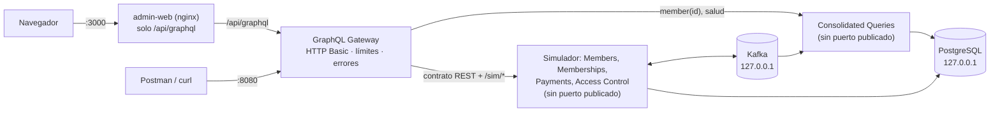

# Entrada única por el gateway y tolerancia a fallos

Este documento resume dos garantías de la plataforma y cómo comprobarlas:

1. **Todo pasa por el GraphQL Gateway.** Ningún cliente llega a un servicio sin pasar por él.
2. **Si algo falla, el sistema sigue en pie, avisa al usuario de forma clara y se recupera solo.**

Para verlo en vivo con la plataforma en marcha: doble clic en `probar-fallos.bat` (35 comprobaciones en 8 escenarios, 2–6 minutos).

## 1. Entrada única



| Puerto en el equipo | Componente | Quién lo usa |
| --- | --- | --- |
| `3000` | Panel (nginx) | Navegador. nginx solo reenvía `/api/graphql` al gateway; cualquier otra ruta `/api/*` responde 404. |
| `8080` | GraphQL Gateway | Clientes GraphQL externos (Postman, la prueba E2E). Exige HTTP Basic. |
| `127.0.0.1:5432`, `127.0.0.1:9092` | PostgreSQL, Kafka | Solo herramientas de desarrollo en este mismo equipo; no son accesibles desde la red. Ningún cliente del sistema los usa. |
| — | Consolidated Queries (8085), simulador (8090) | **Sin puerto publicado.** Solo los alcanza el gateway dentro de la red de Docker. |

Qué se corrigió en esta revisión:

| Antes | Ahora |
| --- | --- |
| Consolidated Queries publicaba `127.0.0.1:8085`: se podía consultar sin pasar por el gateway. | No publica puerto. |
| El estado del sistema lo calculaba el simulador, que a su vez le preguntaba al gateway por su salud (dependencia circular). Si el simulador caía, el panel no sabía qué estaba fallando. | Lo arma el **gateway** (`systemStatus`): se informa a sí mismo, consulta la salud de Consolidated Queries y le pregunta al simulador por él, Kafka y PostgreSQL. Si el simulador no responde, lo marca `DOWN` y lo que solo él informa queda `UNKNOWN`. |
| `clients/access-simulator/README.md` decía que el torniquete llamaba `POST /access-attempts` directamente. | Corregido: usa la mutación `registerAccessAttempt` del gateway. |
| PostgreSQL y Kafka escuchaban en todas las interfaces del equipo. | Solo en `127.0.0.1`. |

Se puede verificar con `docker compose --profile apps ps` (columna `PORTS`) o con la sección 1 de `probar-fallos.bat`.

## 2. Mecanismos de tolerancia a fallos

| Capa | Mecanismo | Qué evita |
| --- | --- | --- |
| Docker Compose | `restart: unless-stopped` en todos los contenedores. | Que un proceso caído quede caído: Docker lo reinicia solo. |
| Docker Compose | El gateway arranca aunque Consolidated Queries o el simulador no estén listos. | Que la falla de un servicio deje sin panel: el gateway lo informa y espera a que vuelva. |
| nginx | Si no logra hablar con el gateway responde JSON `GATEWAY_UNAVAILABLE` (502) o `GATEWAY_TIMEOUT` (504); caché DNS de 5 s. | Páginas HTML de error que el panel no entiende; tardar en notar que el gateway volvió. |
| Gateway | Timeouts de conexión (2 s) y lectura (3–5 s) por servicio. | Solicitudes colgadas. |
| Gateway | **Reintento** único de las lecturas (GET) cuando la conexión falla antes de obtener respuesta. Los comandos (POST) nunca se reintentan. | Errores por cortes de un instante, sin riesgo de registrar dos veces un pago. |
| Gateway | **Disyuntor (circuit breaker)** por servicio: tras 5 fallos seguidos sin respuesta deja de llamarlo 5 s y responde de inmediato; luego deja pasar una llamada de prueba. | Acumular esperas y cargar un servicio que ya está caído. |
| Gateway | Errores con `extensions.upstream` (qué servicio falló) y `extensions.code` (motivo: `STARTING`, `DATABASE_UNAVAILABLE`, `CIRCUIT_OPEN`…), sin hosts, puertos ni trazas. | Mensajes genéricos o que filtren detalles internos. |
| Gateway | `systemStatus` nunca falla: cada componente que no responde se informa `DOWN`. | Quedarse sin diagnóstico justo cuando más se necesita. |
| Simulador | Outbox transaccional: el evento se guarda con el cambio y se publica cuando Kafka está disponible. | Perder eventos si Kafka está caído. |
| Simulador | Base de datos caída → `503 DATABASE_UNAVAILABLE` (no un 500 genérico); `connectionTimeout` 3 s y `statement_timeout` 4 s. | Solicitudes colgadas y errores sin explicación. |
| Simulador | Consumidores Kafka supervisados: si kafkajs no puede reiniciarlos, el proceso termina y Docker lo reinicia. | Que las membresías dejen de activarse en silencio. |
| Simulador y Consolidated Queries | Consumidores idempotentes (`processed_events`). | Aplicar dos veces un evento repetido tras un reinicio. |
| Panel | Catálogo único de errores (`src/lib/errors.ts`): cada error se traduce a *qué pasó*, *detalle* y *posible solución*. | Mensajes técnicos o distintos para el mismo problema. |
| Panel | Aviso de conexión arriba del contenido (solo si hay problemas, se puede ocultar) y aviso "El sistema volvió a estar en línea" al recuperarse, que además refresca los datos. | Que el usuario no sepa por qué algo no funciona ni cuándo volvió. |
| Panel | Reintentos automáticos solo de lo transitorio (red, gateway, servicio caído), nunca de datos inválidos ni de un 401; espera creciente. Timeout propio de 20 s. | Insistir en algo que no se arregla solo; esperar para siempre. |
| Panel | Si una lista no se pudo cargar se dice eso, no "no hay datos"; si hay datos anteriores se muestran aclarando que pueden estar desactualizados. | Confundir una falla con una lista vacía. |
| Panel | `ErrorBoundary`: si una pantalla falla al dibujarse, se muestra cómo seguir en vez de una página en blanco. | Pantalla en blanco por un error de la interfaz. |
| Panel | Red de seguridad global para errores no atrapados (aviso breve, una sola vez por mensaje). | Errores que pasan inadvertidos. |

## 3. Qué ve el usuario en cada falla

| Falla | Aviso en el panel | Posible solución que se muestra | Recuperación |
| --- | --- | --- | --- |
| Gateway caído | "El GraphQL Gateway no responde" (aviso rojo arriba, indicador "Sin conexión"). | Esperar unos segundos; si sigue, `iniciar.bat` o `docker compose ps`. | Automática al volver: aviso verde y datos actualizados. |
| Simulador caído | "Simulador de servicios no responde · No se pueden registrar ni consultar miembros, membresías, pagos ni ingresos." | Puede estar reiniciándose; esperar; si sigue, `iniciar.bat`. | Automática. La ficha consolidada sigue funcionando mientras tanto. |
| PostgreSQL caído | "La base de datos no responde" en cada operación; en el estado, PostgreSQL y Consolidated Queries caídos. | Lo guardado no se pierde y nada quedó a medias; reintentar cuando vuelva. | Automática. |
| Kafka caído | Aviso amarillo: "Los registros se guardan, pero activaciones, ingresos y ficha consolidada se ponen al día cuando Kafka vuelva." | Revisar el estado del sistema y la pantalla Eventos Kafka. | Los eventos pendientes salen solos al volver (outbox). |
| Consolidated Queries caído | Aviso amarillo: "La ficha consolidada no está disponible. El resto del panel funciona." | Se actualiza sola al volver, sin perder eventos. | Automática. |
| Servicio lento | "… tardó demasiado en responder". | Reintentar en unos segundos. | Botón *Reintentar* y reintento automático. |
| Clave incorrecta / sesión vencida | "No se pudo ingresar. Usuario o contraseña incorrectos." Aviso de Bloq Mayús. | Dónde está la clave (`infrastructure/.env`). | — |
| Error de la interfaz | "Esta pantalla tuvo un problema" con *Reintentar* e *Ir al inicio*. | Los datos no se afectaron. | Al cambiar de sección se vuelve a intentar. |

## 4. Errores contemplados en el recorrido guiado

| Paso | Situación | Qué hace el recorrido |
| --- | --- | --- |
| Cualquiera | El progreso guardado está dañado o incompleto. | Lo descarta o muestra "El recorrido guardado quedó incompleto" con *Empezar de nuevo*. |
| Cualquiera | Los datos se reiniciaron (el miembro ya no existe). | Avisa y empieza de nuevo, en vez de quedar en un paso imposible. |
| 1. Registrar miembro | Documento repetido, datos inválidos, servicio caído. | Error junto al campo (con la solución) o aviso con la causa. |
| 2. Asignar plan | No hay planes / no se pudieron cargar. | Botón *Crear un plan* / aviso con *Reintentar* (antes decía "No hay planes" aunque fuera una falla). |
| 2. Asignar plan | El miembro ya tiene una membresía pendiente o activa. | Ofrece *Registrar el pago de esa membresía* o *Seguir con esa membresía*. |
| 3. Registrar pago | La membresía se pagó o venció por fuera del recorrido, o ya no existe. | Ofrece *Continuar al torniquete*, *Asignar un plan nuevo* o *Empezar de nuevo*. |
| 3. Registrar pago | Fecha anterior a la creación de la membresía, monto menor al plan, fecha futura. | Error junto al campo antes de enviar. |
| 3. Registrar pago | La activación no llega en 15 s (Kafka o simulador caídos). | "La activación está tardando más de lo normal": el pago quedó guardado, causa probable y dónde revisar; continúa solo cuando se active. |
| 4. Validar ingreso | Denegado porque Access Control aún no recibe `MEMBERSHIP_ACTIVATED`. | Explica la consistencia eventual; desde el tercer intento sugiere revisar Kafka. |
| 4. Validar ingreso | Denegado por membresía vencida. | Botón *Asignar un plan nuevo*. |
| 5. Ficha consolidada | Consolidated Queries caído o tardando más de 15 s. | Aviso con la causa y *Terminar de todos modos* (el flujo principal ya terminó). |
| Final | `MEMBERSHIP_EXPIRED` no aparece en el visor (Kafka lento o visor caído). | Intenta el ingreso igual a los 8 s y lo aclara; si Access Control aún permite el ingreso, lo explica y ofrece reintentar. |
| Visor de eventos | Kafka o el visor no responden. | Aviso en la columna lateral; el recorrido sigue comprobando cada paso por su cuenta. |

## 5. Validaciones y rechazos del dominio

Los formularios validan antes de enviar con las mismas reglas que el servicio (longitudes, formatos, montos y fechas), y si el servicio rechaza el comando el mensaje aparece **junto al campo que lo causó**:

| Código del servicio | Dónde se muestra | Solución que se sugiere |
| --- | --- | --- |
| `DOCUMENT_ALREADY_REGISTERED` | Campo *Documento* | Buscar a la persona en Miembros. |
| `PLAN_NAME_TAKEN` | Campo *Nombre del plan* | Usar otro nombre o el plan existente. |
| `MEMBERSHIP_ALREADY_OPEN` | Formulario de membresía (y se refresca la lista) | Pagar la pendiente o esperar a que la activa venza. |
| `AMOUNT_BELOW_PLAN_PRICE`, `PAYMENT_IN_FUTURE` | Campos *Monto* / *Fecha* | Corregir el valor. |
| `MEMBERSHIP_NOT_PENDING`, `PAYMENT_ALREADY_REGISTERED` | Formulario de pago (y se refresca la lista) | La membresía ya se pagó o venció. |
| `MEMBERSHIP_NOT_ACTIVE` | Vencimiento forzado | Ya no estaba activa; se refresca la lista. |
| `MEMBER_NOT_FOUND`, `PLAN_NOT_FOUND`, `MEMBERSHIP_NOT_FOUND` | Aviso del formulario | Revisar el número o recargar. |
| Validaciones (`BAD_REQUEST`) | Campo correspondiente según el mensaje del servicio | Corregir el dato. |

En Control de acceso, un número de miembro que no cabe en el tipo `Int` de GraphQL (más de 2.147.483.647) se rechaza antes de enviarlo; si la lista de miembros no carga, el torniquete sigue funcionando escribiendo el número.

## 6. Cómo demostrarlo

Automático: `probar-fallos.bat` recorre el flujo, detiene uno a uno el simulador, PostgreSQL, Kafka, Consolidated Queries y el gateway, comprueba lo que informa el sistema y que se recupere solo, y deja todo en marcha. Crea algunos miembros de prueba; `borrar-datos.bat` los elimina.

Manual, con el panel abierto:

```bash
cd infrastructure
docker compose --profile apps stop services-simulator    # aparece el aviso; Miembros dice "No se pudo cargar"
docker compose --profile apps start services-simulator   # a los segundos: "El sistema volvió a estar en línea"
docker compose --profile apps stop kafka                 # registrar un miembro funciona; la ficha se pone al día al volver
docker compose --profile apps start kafka
```

## 7. Pruebas (16-11-2026)

| Nivel | Comando | Resultado |
| --- | --- | --- |
| Gateway: disyuntor, reintentos, estado armado por el gateway, `extensions.upstream`/`code`, más las pruebas anteriores | `cd gateways/graphql-gateway && ./mvnw test` | 49/49 |
| Simulador: reglas de negocio y detección de base de datos caída | `cd simulator && npm test` | 11/11 |
| Panel: verificación de tipos y compilación | `cd clients/admin-web && npm run build` | correcto |
| Extremo a extremo con caídas reales de cada componente | `probar-fallos.bat` | 35/35 |
